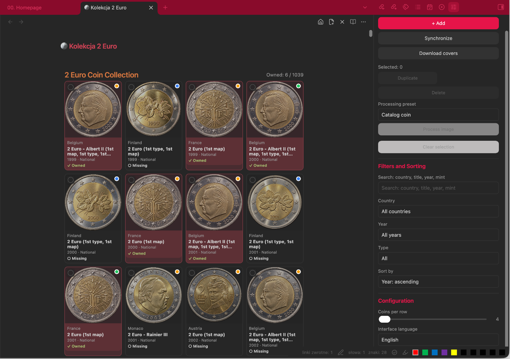
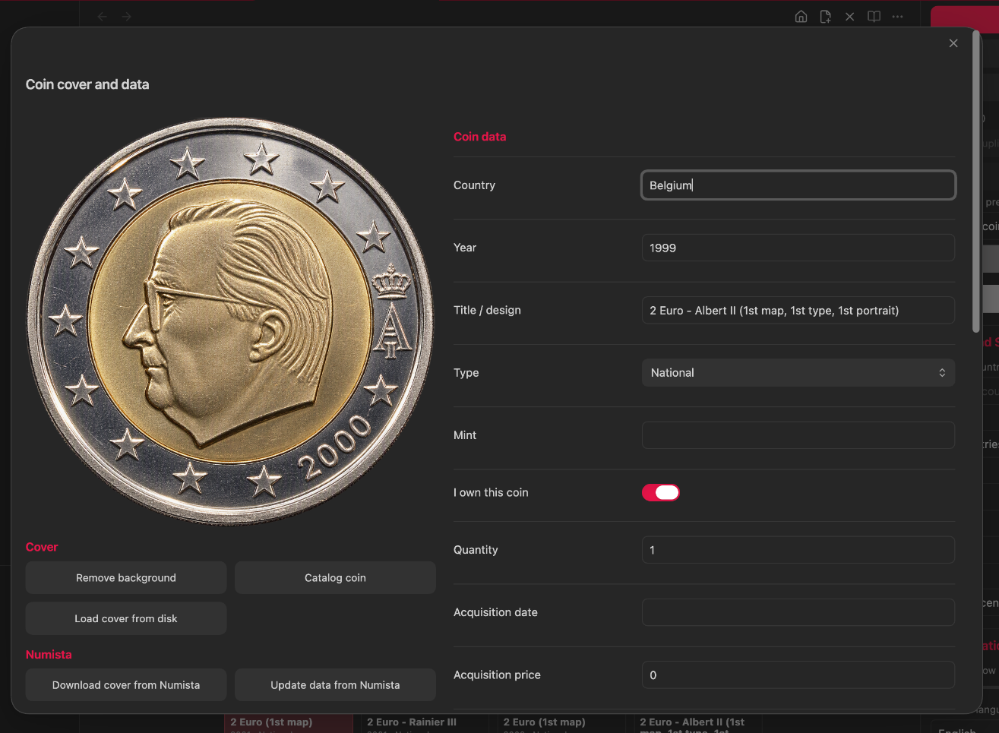
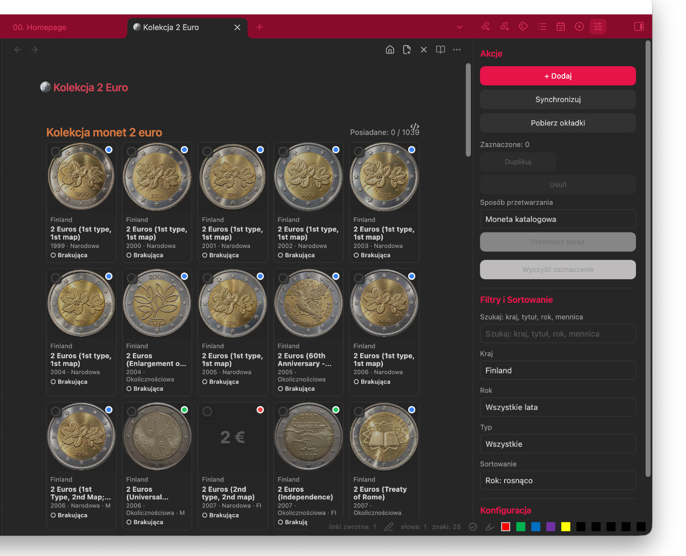
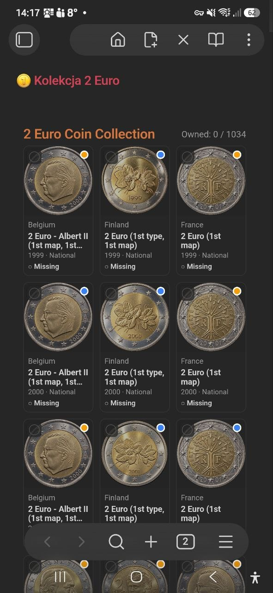
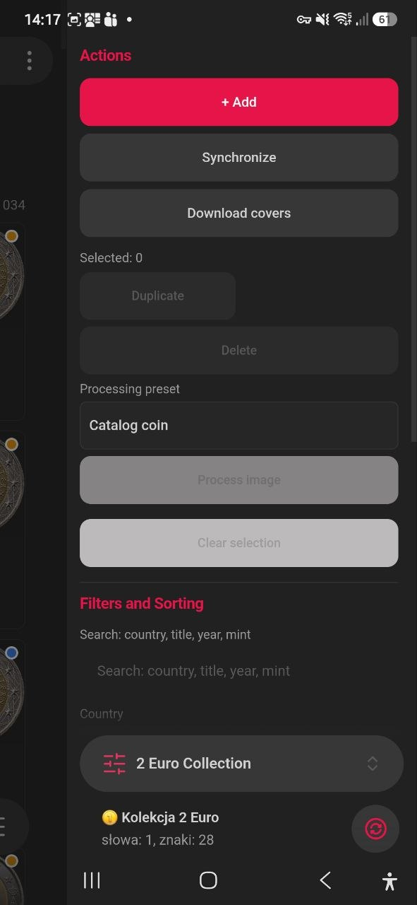
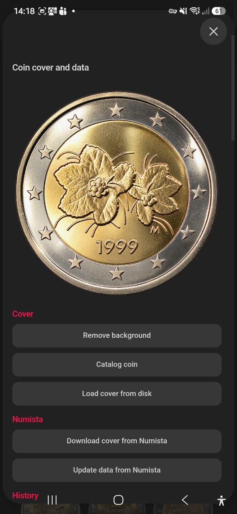

# 2 Euro Collection for Obsidian

[](https://github.com/wkasjanowicz/Obsidian-Two-Euro-Collection/actions/workflows/security.yml)

A mobile-friendly Obsidian plugin for maintaining a structured catalogue of 2 euro coins. The plugin stores every coin as a Markdown note with YAML frontmatter, keeps covers in the vault, can synchronize official issues from Numista, and provides a searchable dashboard with ownership tracking.

<!-- VERSION-START -->
> Current plugin version: **0.7.0**
<!-- VERSION-END -->

> Minimum Obsidian version: **1.13.0**  
> Desktop-only: **No**. The plugin also works in Obsidian Mobile.



## Features

- Generates and maintains a Markdown-based 2 euro coin catalogue: one note per coin issue and mint variant.
- Synchronizes official 2 euro issues from Numista. By default only coins missing from the collection are added, so existing coins cost no API requests.
- Recognizes coins you added manually and links them to Numista instead of creating duplicates.
- Updates Numista prices on demand and keeps a history of the collection value.
- Shows statistics: progress by country and year, collection value (UNC), money spent and coins for swap.
- Groups the grid by country or year; filters by text, country, year, ownership, type and coins for swap.
- Exports lists of missing, owned or swap coins to a Markdown checklist and a CSV file.
- Downloads coin covers into the vault; supports custom covers, cover locking, reference covers and photo attribution.
- Removes image backgrounds (white, black or any uniform colour) and saves covers as compact WebP images.
- Tracks ownership, quantity, acquisition date, price per piece, currency, condition and notes.
- Supports batch selection, duplication, deletion and image processing.
- Interface in English, Polish, German and French.
- Works on desktop and mobile.

## Installation

### Manual installation

1. Close Obsidian or disable the previous version of the plugin.
2. In the target vault, create this folder:

   ```text
   .obsidian/plugins/two-euro-collection/
   ```

3. Copy the following files into that folder:

   ```text
   main.js
   manifest.json
   styles.css
   ```

4. Start Obsidian.
5. Open **Settings → Community plugins**.
6. Turn off **Restricted mode** if required.
7. Enable **2 Euro Collection**.

The final plugin directory should look like this:

```text
.obsidian/plugins/two-euro-collection/
├── main.js
├── manifest.json
└── styles.css
```

> When replacing an existing version, reload Obsidian after copying the files. On mobile, make sure the complete `.obsidian/plugins/two-euro-collection` folder is synchronized to the device.

### First run and initial configuration

After installing the plugin, open **Settings → 2 Euro Collection**.
Before starting, review the collection location settings:

- **Root folder** – the parent folder where the collection will be stored;
- **Collection name** – the name of the 2 euro collection folder;
- **Coins folder** – the folder containing individual coin notes;
- **Covers folder** – the folder used for local coin images.

The **Initial configuration** section contains two setup steps.

#### Step 1: Create collection structure

Select **Create structure**.
The plugin creates the folders required by 2 Euro Collection and the main collection dashboard. Run this step first when configuring a new vault.

Example structure:

`````text
2 Euro/
 ├── 🪙 Kolekcja 2 Euro.md
 ├── Coins/
 └── Covers/

The 🪙 Kolekcja 2 Euro.md note contains the code block used by the plugin to render the collection dashboard::

````markdown
```two-euro-collection

`````

````

Do not remove that code block if the dashboard is to remain visible.

#### Step 2: Install starter collection

This step is optional.

Select **Install starter collection** to add a prepared set of example coins together with their local cover images.

The starter collection is designed to make the initial setup easier. It does not represent the author's collection, and all imported coins initially remain marked as not owned.

During installation:

 -only missing coins are created;
- existing coins are not replaced;
- existing user data is not modified;
- prepared cover images are stored locally;
- starter collection covers are protected from automatic replacement.

Running the starter collection installation again should not create duplicates of existing coins.

After completing the initial configuration, open the collection using the ribbon icon or the **2 Euro Collection: Open collection** command.

#### Adding more coins

After the initial configuration, the catalogue can be expanded in two ways:

**Synchronize with Numista**
- Configure your Numista API key.
- Open the collection dashboard.
- Open the **2 Euro Collection** sidebar if it is not already visible.
- Select **Synchronize**.
- Wait for the synchronization to finish.
- If required, select **Download covers** to download missing local images.

Synchronization creates or updates notes for official 2 euro issues while preserving local ownership data and protected or custom covers.

**Add coins manually**
- Select + Add in the sidebar or run 2 Euro Collection: Add coin.
- Enter at least Country, Year, and Title / design.
- Select National or Commemorative.
- Add a mint mark when the issue has a mint variant.
- Select Save.

Manual entries use `source: manual` and are not removed by the command that cleans unofficial Numista imports.

## Numista API configuration

Numista provides API access to its numismatic catalogue. Sign in to Numista, activate API access, and generate an API key from the Numista API page. See the [official Numista API page](https://en.numista.com/api/index.php) and [API documentation](https://en.numista.com/api/doc/index.php).

To configure the plugin:

1. Open **Obsidian Settings → 2 Euro Collection**.
2. Paste the key into **Numista API key**.
3. Leave the settings page. Obsidian saves the plugin settings automatically.
4. Run **Synchronize**.

> The API key is kept in Obsidian's secure secret storage (choose or create a secret in the **Numista API key** field); a key saved by older plugin versions in `data.json` is moved there automatically.

### Synchronization, prices and API requests

- **Only new coins (default).** Synchronization skips coins already in the collection without sending any request for them. A coin is recognized by its Numista id or, for coins added manually, by country, year, title and mint (punctuation and case are ignored). Manually added coins are linked to Numista instead of being duplicated. To re-check and update existing coins, enable **Update existing coins during synchronization** in the settings.
- **National coins** are one Numista type spanning many years. Without a year filter the plugin adds only the missing years. Use a year filter for the fastest synchronization.
- **Prices** are not downloaded during synchronization. Use **Update prices** in the side panel: it updates the coins visible on the dashboard (current filters) and asks for confirmation with the number of requests it will use. Each coin in the coin editor also has **Update data from Numista**.
- **Request counter.** After each operation a notice shows the number of Numista requests used; the plugin settings show the total for the current month.
- **Cache.** Catalogue data downloaded from Numista is reused for 7 days (configurable, 0 disables it), so repeating a synchronization of the same range is almost free.
- **Stop.** While a synchronization, price update, cover download or conversion is running, the side panel shows a **Stop** button (also available as a command).
- If Numista rejects the API key (HTTP 401/403), synchronization stops at once with a clear message.
- **Show the last synchronization report** (command) lists the Numista types skipped during the last synchronization with the reason (other country, not an official 2 euro coin, matched an existing coin…), which helps when a coin is missing.

### What synchronization reads from Numista

For supported official issues, the plugin can read and store:

- issuer/country;
- year and mint letter;
- title/design;
- standard or commemorative type;
- Numista type and issue identifiers;
- Numista URL;
- mintage;
- obverse image URL;
- photo author/copyright and photo license metadata when supplied;
- numismatic values by grade in EUR when supplied by the API.

The synchronizer filters the results to official 2 euro issuers and standard-circulation or circulating commemorative object types. Entries identified as medals, tokens, patterns, trials, fantasy issues, souvenirs, replicas, or copies are excluded. The command **Remove unofficial Numista imports** can clean older imported entries while preserving owned coins, locked covers, custom covers, and manual entries.

## Reading local coin data

Each catalogue entry is a normal Markdown file in the `Coins` folder. The plugin reads the YAML frontmatter and renders it as a dashboard card.

Example:

```yaml
---
coin_id: coin-12345-67890
denomination: 2
currency: EUR
country: Finland
year: '1999'
coin_type: national
title: 2 Euro (1st type, 1st map)
mint_mark: M
owned: true
quantity: 1
acquisition_date: 2026-01-15
acquisition_price: 4.50
acquisition_currency: EUR
condition: UNC
source: numista
numista_id: '12345'
numista_issue_id: '67890'
cover: '[[11 - Collections/2 Euro/Covers/Finland-1999-National-M.png]]'
reference_year: '1999'
cover_locked: true
own_cover: false
---
````

You may inspect or edit these notes directly, but using the plugin editor is safer because it normalizes fields and refreshes the dashboard.

## Covers and images

Covers are stored in the configured `Covers` folder and linked from coin frontmatter.

### Download missing covers

Use **Download covers** in the sidebar or run **2 Euro Collection: Download missing covers**. The operation:

- processes Numista entries without a local cover;
- skips locked covers;
- downloads the Numista obverse picture;
- saves the image locally;
- updates the Markdown note.

### Manage one coin cover

Click the coin image to open **Coin cover and data**.



Available cover actions:

- **Remove background**: removes a light background and saves a protected PNG.
- **Catalog coin**: removes the background, crops and centers the coin, applies a light contrast/highlight adjustment, saves a PNG, and locks the cover.
- **Load cover from disk**: imports a local image, marks it as a custom cover, sets the reference year to the coin year, and locks it.
- **Download cover from Numista**: downloads the Numista image for that coin.
- **Update data from Numista**: refreshes catalogue data, photo attribution, mintage, and available valuation fields.
- **Undo change**: restores the last saved note and cover snapshot for that coin.

### Cover protection and reference covers

- **Lock cover** (`cover_locked: true`) prevents synchronization and bulk downloading from replacing the image.
- **Custom cover** (`own_cover: true`) also activates cover protection.
- **Cover reference year** lets another issue reuse an already available cover from the same country and coin type.
- Reference-year suggestions are taken from locked coins with the same country, title, and type.

### Image indicator dots

The dot in the upper-right corner of a coin image describes the cover state:

- **Green**: the image matches the coin year.
- **Orange**: the card uses a reference image from another year.
- **Red**: the reference year is missing or the requested reference image could not be resolved.
- **Blue**: a custom cover is in use and protected.

These dots indicate image/reference status. They do not indicate whether the coin is owned.

## Filtering and sorting

Open the right sidebar with **2 Euro Collection: Open collection panel**. The dashboard can be filtered by:

- **Search**: country, title, year, or mint mark;
- **Country**;
- **Year**;
- **All**;
- **Owned**;
- **Missing**;
- **Commemorative**;
- **National**;
- **For swap (2+)**: owned coins you have at least two pieces of.

Available sorting modes:

- Year: ascending;
- Year: descending;
- Country: ascending;
- Country: descending.

**Group by** country or year adds headings with the progress of each group (for example `France 34 / 41`). The group order follows the sort direction.

The counter above the grid is calculated from the currently filtered list, for example `Owned: 6 / 48` after applying filters. Filters, sorting and grouping are remembered after restarting Obsidian.

Keyboard: use the arrow keys to move between cards, **Enter** to open a coin and **Space** to select it.



## Statistics and value history

Expand **Statistics** above the grid. All figures are calculated for the coins matching the current filters:

- owned coins and progress, for example `34 / 41 (83%)`;
- **collection value (UNC)**: Numista UNC price × quantity of owned coins;
- **spent on purchases**: acquisition price per piece × quantity, per currency;
- **coins for swap** and the number of spare pieces;
- progress **by country** and **by year** with progress bars.

The **value history** stores one snapshot of the whole collection per day. A snapshot is saved automatically after **Update prices**, or manually with the command **Save collection value snapshot**.

## Exporting lists

In the side panel choose **Missing coins**, **Owned coins** or **Coins for swap** and click **Export list** (also available as commands). The export uses the current country, year, type and search filters and creates two files in the collection folder:

- a Markdown note with a checklist grouped by country and links to Numista, which opens automatically;
- a CSV file for spreadsheets (UTF-8, opens correctly in Excel).

The swap list includes the number of spare pieces, the owned list the quantity.

## Editing coins and using editing fields

### Edit complete coin data

Click the text area below a coin image to open the standard editor. Click the image to open the combined cover-and-data editor.

Editable fields include:

- Country;
- Year;
- Title / design;
- Type;
- Mint;
- I own this coin;
- Quantity;
- Acquisition date;
- Acquisition price **per piece** and currency;
- Condition;
- Cover URL;
- Cover reference year;
- Lock cover;
- Custom cover;
- Notes;
- Photo author/copyright;
- Photo license.

The numismatic value field is read-only because it is populated from Numista.

### Reference-year editing filter

When editing **Cover reference year**, the plugin proposes years only from coins that satisfy all of these conditions:

1. the country is the same;
2. the normalized title is the same;
3. the coin type is the same;
4. the candidate cover is locked;
5. the candidate has a local cover.

This prevents unrelated covers from being offered as references.

### Batch editing and image processing

1. Select cards using the checkbox in the upper-left corner of each card.
2. The sidebar displays the number of selected coins.
3. Choose **Catalog coin** or **Remove background** under **Processing preset**.
4. Select **Process image**.
5. Use **Clear selection** when finished.

Selected coins can also be duplicated or deleted. Deletion requires confirmation and cannot be undone through the batch action.

## Ownership tracking

A coin is owned when **I own this coin** is enabled, which stores `owned: true` in frontmatter.

- Owned cards display `✓ Owned`.
- Missing cards display `○ Missing`.
- Owned cards use a red-tinted card background in version 0.5.46.
- The top counter shows owned entries versus all entries remaining after active filters.
- Use **Quantity** when more than one copy is held.

> The ownership color is applied to the card background. The green, orange, red, and blue dots on the image describe cover/reference status instead.

## Mobile use

The plugin is not desktop-only. Install or synchronize the complete plugin folder to the mobile vault, enable the plugin in **Community plugins**, and open the collection note.

On a phone:

- the dashboard automatically uses a three-column grid;
- the collection sidebar can be opened from the plugin panel icon;
- filters, synchronization, cover downloads, and batch actions remain available;
- the coin editor changes to a single-column layout;
- tapping a coin image opens the cover-and-data editor;
- tapping the text below the image opens the standard coin editor.

### Mobile dashboard



### Mobile actions, filters, and sorting



### Mobile cover and coin data editor



## Interface language and layout

In the right sidebar or plugin settings you can choose:

- **Automatic** (follows the Obsidian language);
- **English**;
- **Polski**;
- **Deutsch**;
- **Français**.

### Folders and default currency

The folder names, the dashboard note name and the default purchase currency are set in the plugin settings. Folder changes are applied with **Apply folder settings**: existing coins, covers and the dashboard are moved to the new location and cover links in coin notes are updated.

The **Coins per row** slider supports values from 4 to 10 on desktop. Mobile uses a responsive three-column layout.

## Useful commands

Open the Command Palette and search for **2 Euro Collection**. Important commands include:

- Open collection;
- Open collection panel;
- Add coin;
- Synchronize catalogue with Numista;
- Update Numista prices of filtered coins;
- Download missing covers;
- Export missing / owned / swap coins to Markdown and CSV;
- Save collection value snapshot;
- Stop the running synchronization or batch operation;
- Remove background from current coin cover;
- Apply Catalog coin preset to current coin;
- Copy diagnostics for a bug report.

Repair commands start with **Maintenance:**, for example *Maintenance: remove duplicates*, *Maintenance: convert PNG covers to WebP*, *Maintenance: remove unofficial Numista imports* and *Maintenance: normalize 2 Euro coin titles*.

### Covers in WebP

Background removal and the Catalog coin preset save covers as WebP images (up to 1200 px), which are many times smaller than PNG and keep transparency. **Maintenance: convert PNG covers to WebP** converts existing PNG covers and moves the PNG files to the trash.

## Backup and safety recommendations

Before a large synchronization, cleanup, title normalization, cover migration, or batch deletion:

1. close active coin editors;
2. make a backup or Git commit of the vault;
3. verify that custom covers have **Custom cover** or **Lock cover** enabled;
4. test the operation on a small copy of the vault when upgrading from an older version.

## Troubleshooting

### Reporting a problem

Run **Copy diagnostics for a bug report** and paste the result into the issue. It contains the plugin and Obsidian versions, platform, collection counts and settings, but never the Numista API key.

### The plugin is not visible in Community plugins

- Confirm that the folder name is exactly `.obsidian/plugins/two-euro-collection`.
- Confirm that `manifest.json`, `main.js`, and `styles.css` are directly inside that folder.
- Reload Obsidian.
- Check `.obsidian/community-plugins.json` and confirm that `two-euro-collection` is listed after the plugin is enabled.

### Polish language is not available

Polish is built into the plugin since version 0.6.4. Select it in the plugin settings
(**Interface language**) or use **Automatic** with Obsidian set to Polish.

Translations placed in `.obsidian/plugins/two-euro-collection/Languages/` still override
the built-in strings. The folder name uses a capital `L`.

### Synchronization asks for an API key

Open **Settings → 2 Euro Collection**, enter a valid Numista API key, and run synchronization again.

### Covers do not appear

- Run **Migrate cover references** for old links containing only a filename.
- Confirm that cover files are inside the configured `Covers` folder.
- Use **Download missing covers** for unlocked Numista entries.
- Verify `cover_locked`, `own_cover`, and `reference_year` in the affected note.

### Synchronization is slow or reports HTTP 429

The plugin spaces API calls and retries rate-limited requests with increasing delays. Leave Obsidian open until the progress notice completes. Avoid starting multiple synchronization or cover-download operations at the same time.

## Data ownership and third-party content

Coin notes and downloaded covers are stored in the user's Obsidian vault. Numista catalogue data and images remain subject to Numista's terms and the license/attribution information supplied with each image. Keep the `photo_author`, `photo_license`, and related source information when redistributing images or generated catalogue content.

## Screenshots

The screenshots in `Assets/` are documentation examples. Desktop screenshots were cropped to show the plugin workspace without the author's personal Obsidian navigation menu.

## License

No software license is declared in the current plugin package. Add a `LICENSE` file before public distribution if the plugin is intended for reuse by others.
