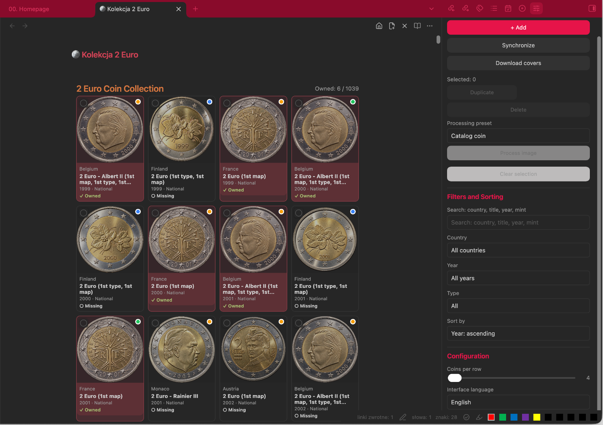
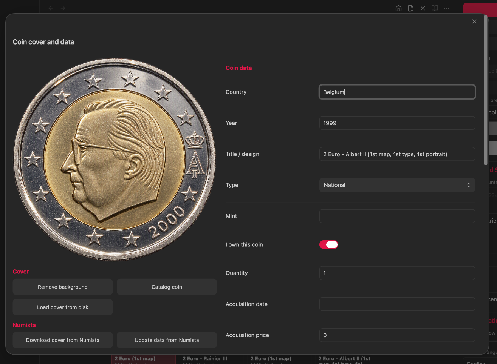
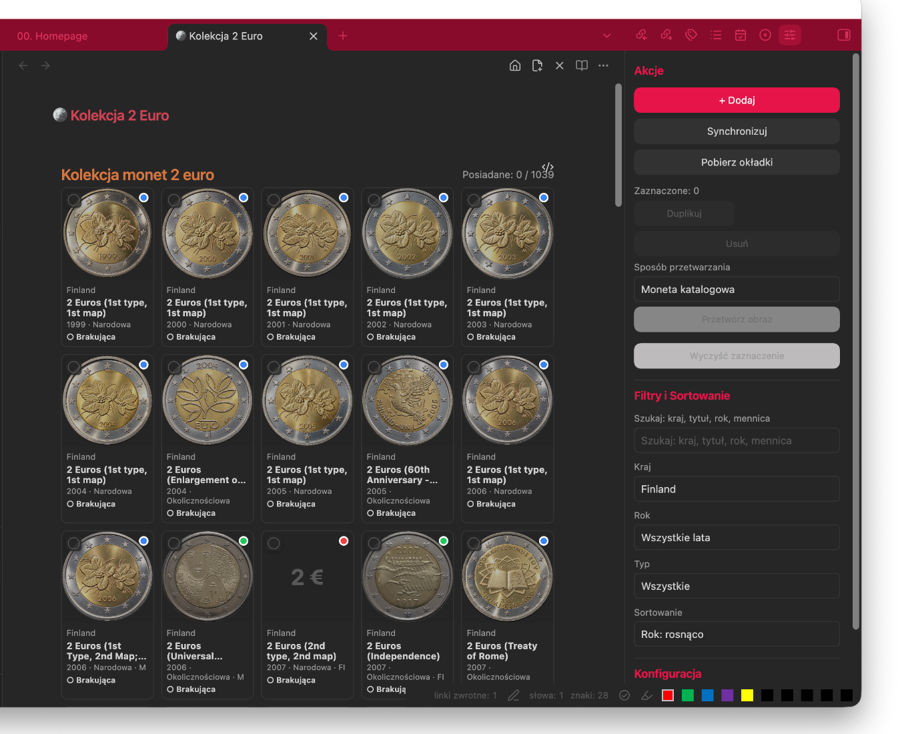
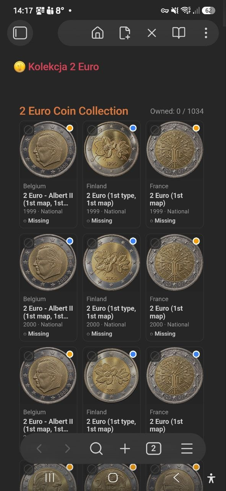
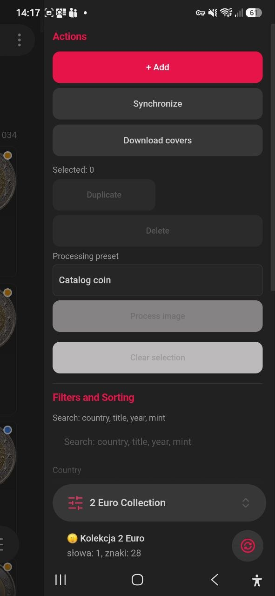
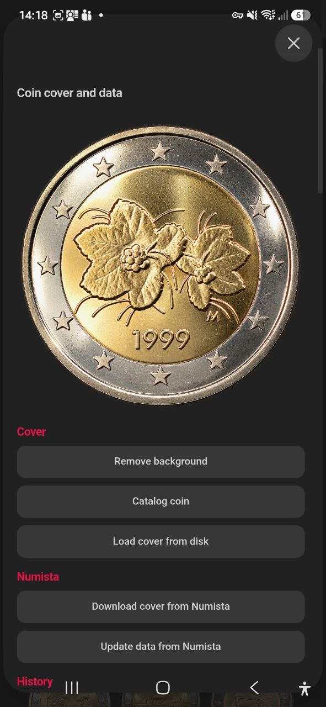

# 2 Euro Collection for Obsidian

A mobile-friendly Obsidian plugin for maintaining a structured catalogue of 2 euro coins. The plugin stores every coin as a Markdown note with YAML frontmatter, keeps covers in the vault, can synchronize official issues from Numista, and provides a searchable dashboard with ownership tracking.

<!-- VERSION-START -->
> Current plugin version: **0.5.51**
<!-- VERSION-END --> 
> Minimum Obsidian version: **1.8.0**  
> Desktop-only: **No**. The plugin also works in Obsidian Mobile.



## Features

- Generates and maintains a Markdown-based 2 euro coin catalogue.
- Synchronizes official standard-circulation and circulating commemorative 2 euro issues from Numista.
- Stores one note per coin issue and mint variant.
- Downloads coin covers and keeps them inside the Obsidian vault.
- Supports local/custom covers, cover locking, reference covers, and photo attribution fields.
- Tracks ownership, quantity, acquisition date, acquisition price, currency, condition, and notes.
- Filters by free text, country, year, ownership, and coin type.
- Sorts by year or country, ascending or descending.
- Supports batch selection, duplication, deletion, background removal, and the **Catalog coin** image preset.
- Provides English and Polish user interfaces.
- Works on desktop and mobile.

## Installation

### Manual installation

1. Close Obsidian or disable the previous version of the plugin.
2. In the target vault, create this folder:

   ```text
   .obsidian/plugins/two-euro-collection/
   ```

3. Copy the following files into that folder:

   ```text
   main.js
   manifest.json
   styles.css
   Languages/pl.json
   ```

4. Start Obsidian.
5. Open **Settings → Community plugins**.
6. Turn off **Restricted mode** if required.
7. Enable **2 Euro Collection**.

The final plugin directory should look like this:

```text
.obsidian/plugins/two-euro-collection/
├── main.js
├── manifest.json
├── styles.css
└── Languages/
    └── pl.json
```

> When replacing an existing version, reload Obsidian after copying the files. On mobile, make sure the complete `.obsidian/plugins/two-euro-collection` folder is synchronized to the device.

## First run and initial folder structure

1. Open **Settings → 2 Euro Collection**.
2. Review the default paths:
   - Root folder: `11 - Collections`
   - Collection name: `2 Euro`
   - Coins folder: `Coins`
   - Covers folder: `Covers`
3. Select **Create / repair structure → Run**.
4. Run the command **2 Euro Collection: Open collection**, or use the ribbon icon.

The plugin creates this structure when required:

```text
11 - Collections/
└── 2 Euro/
    ├── 🪙 Kolekcja 2 Euro.md
    ├── Coins/
    │   ├── Austria/
    │   ├── Belgium/
    │   └── ...
    ├── Covers/
    └── .history/
```

The dashboard note contains the plugin code block:

````markdown
```two-euro-collection
```
````

Do not remove that code block if the dashboard is to remain visible.

## Generating the initial catalogue

There are two ways to create the initial data.

### Option A: synchronize from Numista

1. Configure the Numista API key as described below.
2. Open the collection dashboard.
3. Open the right-side **2 Euro Collection** panel if it is not already visible.
4. Select **Synchronize**.
5. Wait for the progress notice to finish.
6. Select **Download covers** to download missing local images.

Synchronization creates or updates Markdown notes for official 2 euro issues. The plugin distinguishes year and mint variants, and preserves ownership data and protected/custom covers already stored locally.

### Option B: add coins manually

1. Select **+ Add** in the right sidebar, or run **2 Euro Collection: Add coin**.
2. Enter at least **Country**, **Year**, and **Title / design**.
3. Choose **National** or **Commemorative**.
4. Add a mint mark when the issue has a mint variant.
5. Select **Save**.

Manual entries use `source: manual` and are not removed by the command that cleans unofficial Numista imports.

## Numista API configuration

Numista provides API access to its numismatic catalogue. Sign in to Numista, activate API access, and generate an API key from the Numista API page. See the [official Numista API page](https://en.numista.com/api/index.php) and [API documentation](https://en.numista.com/api/doc/index.php).

To configure the plugin:

1. Open **Obsidian Settings → 2 Euro Collection**.
2. Paste the key into **Numista API key**.
3. Leave the settings page. Obsidian saves the plugin settings automatically.
4. Run **Synchronize**.

> The API key is stored in the plugin's Obsidian settings data. Do not publish or commit the generated `data.json` with a real API key.

### What synchronization reads from Numista

For supported official issues, the plugin can read and store:

- issuer/country;
- year and mint letter;
- title/design;
- standard or commemorative type;
- Numista type and issue identifiers;
- Numista URL;
- mintage;
- obverse image URL;
- photo author/copyright and photo license metadata when supplied;
- numismatic values by grade in EUR when supplied by the API.

The synchronizer filters the results to official 2 euro issuers and standard-circulation or circulating commemorative object types. Entries identified as medals, tokens, patterns, trials, fantasy issues, souvenirs, replicas, or copies are excluded. The command **Remove unofficial Numista imports** can clean older imported entries while preserving owned coins, locked covers, custom covers, and manual entries.

## Reading local coin data

Each catalogue entry is a normal Markdown file in the `Coins` folder. The plugin reads the YAML frontmatter and renders it as a dashboard card.

Example:

```yaml
---
coin_id: coin-12345-67890
denomination: 2
currency: EUR
country: Finland
year: "1999"
coin_type: national
title: 2 Euro (1st type, 1st map)
mint_mark: M
owned: true
quantity: 1
acquisition_date: 2026-01-15
acquisition_price: 4.50
acquisition_currency: EUR
condition: UNC
source: numista
numista_id: "12345"
numista_issue_id: "67890"
cover: "[[11 - Collections/2 Euro/Covers/Finland-1999-National-M.png]]"
reference_year: "1999"
cover_locked: true
own_cover: false
---
```

You may inspect or edit these notes directly, but using the plugin editor is safer because it normalizes fields and refreshes the dashboard.

## Covers and images

Covers are stored in the configured `Covers` folder and linked from coin frontmatter.

### Download missing covers

Use **Download covers** in the sidebar or run **2 Euro Collection: Download missing covers**. The operation:

- processes Numista entries without a local cover;
- skips locked covers;
- downloads the Numista obverse picture;
- saves the image locally;
- updates the Markdown note.

### Manage one coin cover

Click the coin image to open **Coin cover and data**.



Available cover actions:

- **Remove background**: removes a light background and saves a protected PNG.
- **Catalog coin**: removes the background, crops and centers the coin, applies a light contrast/highlight adjustment, saves a PNG, and locks the cover.
- **Load cover from disk**: imports a local image, marks it as a custom cover, sets the reference year to the coin year, and locks it.
- **Download cover from Numista**: downloads the Numista image for that coin.
- **Update data from Numista**: refreshes catalogue data, photo attribution, mintage, and available valuation fields.
- **Undo change**: restores the last saved note and cover snapshot for that coin.

### Cover protection and reference covers

- **Lock cover** (`cover_locked: true`) prevents synchronization and bulk downloading from replacing the image.
- **Custom cover** (`own_cover: true`) also activates cover protection.
- **Cover reference year** lets another issue reuse an already available cover from the same country and coin type.
- Reference-year suggestions are taken from locked coins with the same country, title, and type.

### Image indicator dots

The dot in the upper-right corner of a coin image describes the cover state:

- **Green**: the image matches the coin year.
- **Orange**: the card uses a reference image from another year.
- **Red**: the reference year is missing or the requested reference image could not be resolved.
- **Blue**: a custom cover is in use and protected.

These dots indicate image/reference status. They do not indicate whether the coin is owned.

## Filtering and sorting

Open the right sidebar with **2 Euro Collection: Open collection panel**. The dashboard can be filtered by:

- **Search**: country, title, year, or mint mark;
- **Country**;
- **Year**;
- **All**;
- **Owned**;
- **Missing**;
- **Commemorative**;
- **National**.

Available sorting modes:

- Year: ascending;
- Year: descending;
- Country: ascending;
- Country: descending.

The counter above the grid is calculated from the currently filtered list, for example `Owned: 6 / 48` after applying filters.



## Editing coins and using editing fields

### Edit complete coin data

Click the text area below a coin image to open the standard editor. Click the image to open the combined cover-and-data editor.

Editable fields include:

- Country;
- Year;
- Title / design;
- Type;
- Mint;
- I own this coin;
- Quantity;
- Acquisition date;
- Acquisition price and currency;
- Condition;
- Cover URL;
- Cover reference year;
- Lock cover;
- Custom cover;
- Notes;
- Photo author/copyright;
- Photo license.

The numismatic value field is read-only because it is populated from Numista.

### Reference-year editing filter

When editing **Cover reference year**, the plugin proposes years only from coins that satisfy all of these conditions:

1. the country is the same;
2. the normalized title is the same;
3. the coin type is the same;
4. the candidate cover is locked;
5. the candidate has a local cover.

This prevents unrelated covers from being offered as references.

### Batch editing and image processing

1. Select cards using the checkbox in the upper-left corner of each card.
2. The sidebar displays the number of selected coins.
3. Choose **Catalog coin** or **Remove background** under **Processing preset**.
4. Select **Process image**.
5. Use **Clear selection** when finished.

Selected coins can also be duplicated or deleted. Deletion requires confirmation and cannot be undone through the batch action.

## Ownership tracking

A coin is owned when **I own this coin** is enabled, which stores `owned: true` in frontmatter.

- Owned cards display `✓ Owned`.
- Missing cards display `○ Missing`.
- Owned cards use a red-tinted card background in version 0.5.46.
- The top counter shows owned entries versus all entries remaining after active filters.
- Use **Quantity** when more than one copy is held.

> The ownership color is applied to the card background. The green, orange, red, and blue dots on the image describe cover/reference status instead.

## Mobile use

The plugin is not desktop-only. Install or synchronize the complete plugin folder to the mobile vault, enable the plugin in **Community plugins**, and open the collection note.

On a phone:

- the dashboard automatically uses a three-column grid;
- the collection sidebar can be opened from the plugin panel icon;
- filters, synchronization, cover downloads, and batch actions remain available;
- the coin editor changes to a single-column layout;
- tapping a coin image opens the cover-and-data editor;
- tapping the text below the image opens the standard coin editor.

### Mobile dashboard



### Mobile actions, filters, and sorting



### Mobile cover and coin data editor



## Interface language and layout

In the right sidebar or plugin settings you can choose:

- **Automatic**;
- **English**;
- **Polski**.

The **Coins per row** slider supports values from 4 to 10 on desktop. Mobile uses a responsive three-column layout.

## Useful commands

Open the Command Palette and search for **2 Euro Collection**. Important commands include:

- Open collection;
- Open collection panel;
- Add coin;
- Synchronize catalogue with Numista;
- Download missing covers;
- Remove duplicates;
- Remove background from current coin cover;
- Apply Catalog coin preset to current coin;
- Normalize protected PNG cover names;
- Normalize 2 Euro coin titles;
- Normalize country folder names;
- Migrate cover references;
- Remove unofficial Numista imports.

## Backup and safety recommendations

Before a large synchronization, cleanup, title normalization, cover migration, or batch deletion:

1. close active coin editors;
2. make a backup or Git commit of the vault;
3. verify that custom covers have **Custom cover** or **Lock cover** enabled;
4. test the operation on a small copy of the vault when upgrading from an older version.

## Troubleshooting

### The plugin is not visible in Community plugins

- Confirm that the folder name is exactly `.obsidian/plugins/two-euro-collection`.
- Confirm that `manifest.json`, `main.js`, and `styles.css` are directly inside that folder.
- Reload Obsidian.
- Check `.obsidian/community-plugins.json` and confirm that `two-euro-collection` is listed after the plugin is enabled.

### Polish language is not available

Confirm that the file exists at:

```text
.obsidian/plugins/two-euro-collection/Languages/pl.json
```

The folder name uses a capital `L`.

### Synchronization asks for an API key

Open **Settings → 2 Euro Collection**, enter a valid Numista API key, and run synchronization again.

### Covers do not appear

- Run **Migrate cover references** for old links containing only a filename.
- Confirm that cover files are inside the configured `Covers` folder.
- Use **Download missing covers** for unlocked Numista entries.
- Verify `cover_locked`, `own_cover`, and `reference_year` in the affected note.

### Synchronization is slow or reports HTTP 429

The plugin spaces API calls and retries rate-limited requests with increasing delays. Leave Obsidian open until the progress notice completes. Avoid starting multiple synchronization or cover-download operations at the same time.

## Data ownership and third-party content

Coin notes and downloaded covers are stored in the user's Obsidian vault. Numista catalogue data and images remain subject to Numista's terms and the license/attribution information supplied with each image. Keep the `photo_author`, `photo_license`, and related source information when redistributing images or generated catalogue content.

## Screenshots

The screenshots in `Assets/` are documentation examples. Desktop screenshots were cropped to show the plugin workspace without the author's personal Obsidian navigation menu.

## License

No software license is declared in the current plugin package. Add a `LICENSE` file before public distribution if the plugin is intended for reuse by others.
