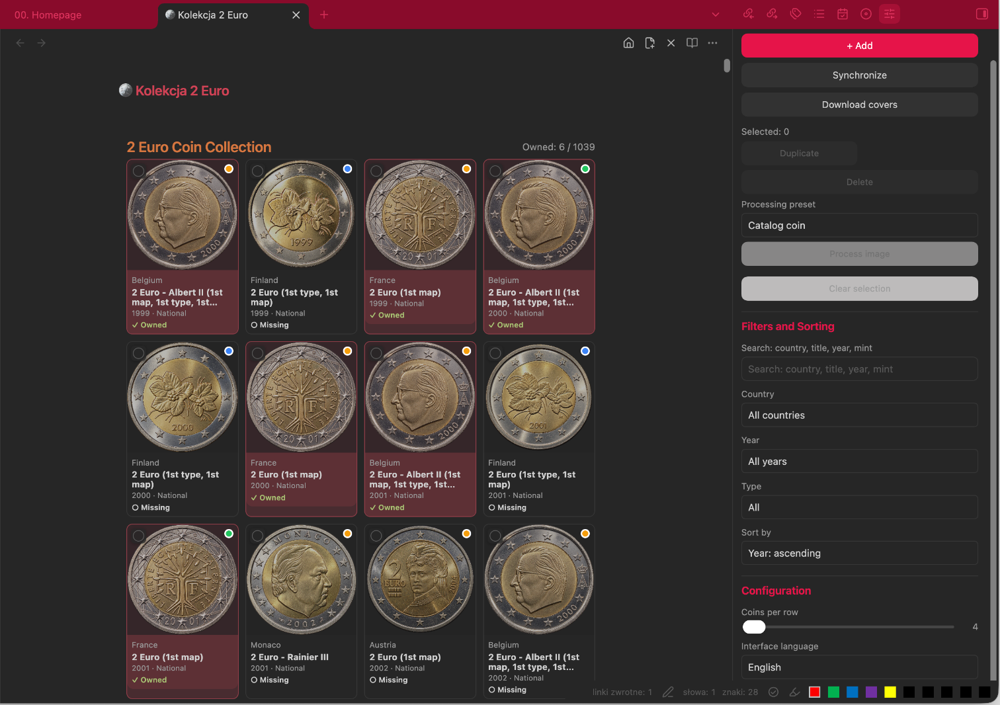
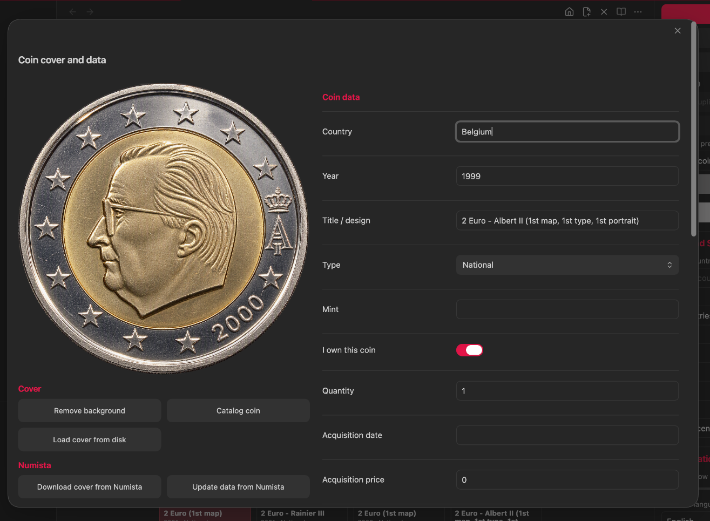
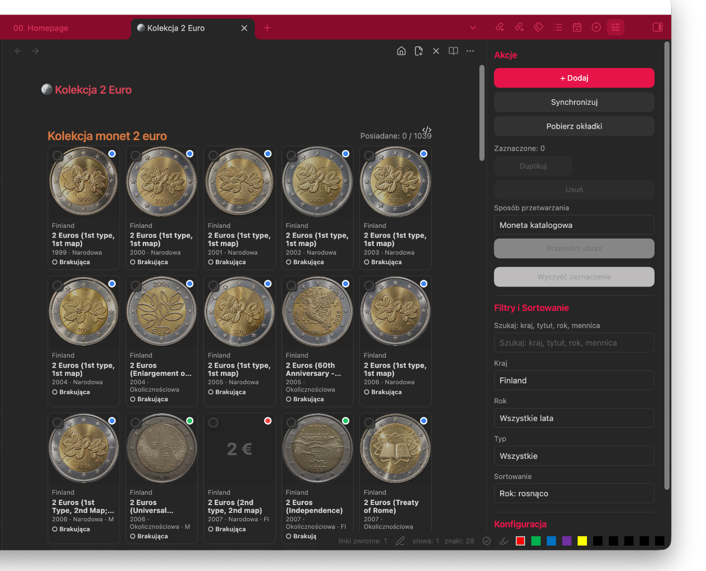
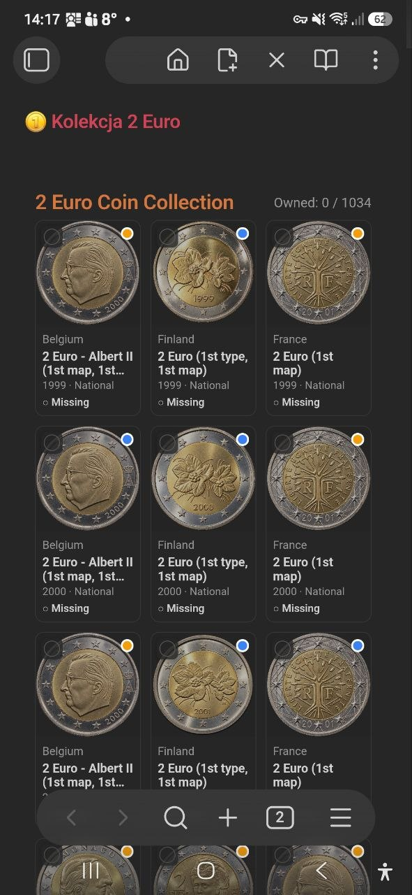
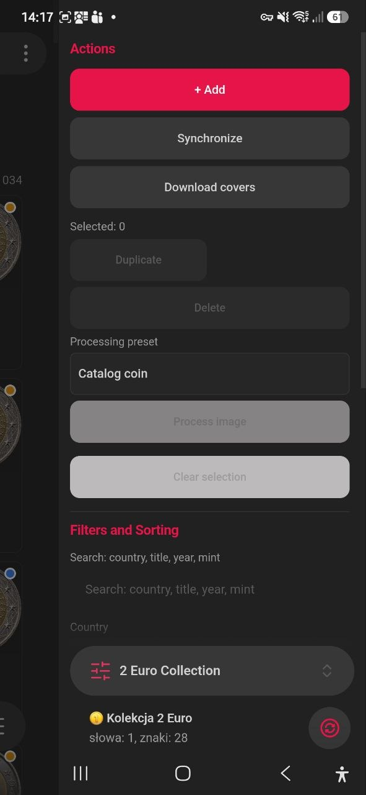
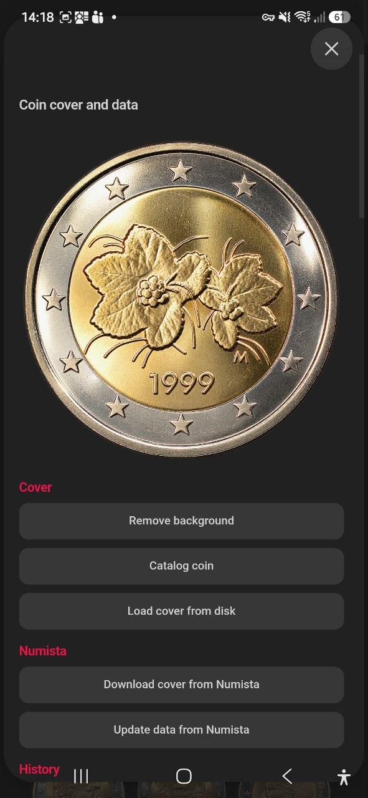

# 2 Euro Collection dla Obsidian

[](https://github.com/wkasjanowicz/Obsidian-Two-Euro-Collection/actions/workflows/security.yml)

Mobilna wtyczka do Obsidian służąca do prowadzenia uporządkowanego katalogu monet 2 euro. Każda moneta jest zapisywana jako notatka Markdown z frontmatter YAML, okładki są przechowywane lokalnie w vault, a katalog może być synchronizowany z Numista. Wtyczka udostępnia dashboard z wyszukiwaniem, filtrami i oznaczaniem posiadanych monet.

<!-- VERSION-START -->
> Aktualna wersja wtyczki: **0.7.1**
<!-- VERSION-END -->

> Minimalna wersja Obsidian: **1.13.0**  
> Tylko desktop: **Nie**. Wtyczka działa również w Obsidian Mobile.



## Najważniejsze funkcje

- Generowanie i utrzymywanie katalogu monet 2 euro w plikach Markdown: osobna notatka dla każdej emisji i wariantu mennicy.
- Synchronizacja oficjalnych monet 2 euro z Numista. Domyślnie dodawane są tylko monety, których brakuje w kolekcji, więc posiadane monety nie zużywają zapytań API.
- Rozpoznawanie monet dodanych ręcznie i łączenie ich z Numista zamiast tworzenia duplikatów.
- Aktualizacja cen Numista na żądanie i historia wartości kolekcji.
- Statystyki: postęp według krajów i lat, wartość kolekcji (UNC), wydatki i monety do wymiany.
- Grupowanie siatki według kraju lub roku; filtry: tekst, kraj, rok, posiadanie, typ i monety do wymiany.
- Eksport list brakujących, posiadanych lub wymiennych monet do listy Markdown i pliku CSV.
- Cotygodniowe sprawdzanie w Numiście nowych monet 2 euro, których nie ma jeszcze w kolekcji, z propozycją synchronizacji.
- Widok kolekcji w Bazach (Bases) Obsidiana: galeria okładek i tabele wszystkich, brakujących, posiadanych monet i monet do wymiany.
- Pobieranie okładek do vaulta; własne okładki, blokada okładki, okładki referencyjne i dane o autorze zdjęcia.
- Usuwanie tła ze zdjęć (białego, czarnego lub dowolnego jednolitego) i zapis okładek w lekkim formacie WebP.
- Oznaczanie posiadania, liczby sztuk, daty i ceny zakupu za sztukę, waluty, stanu oraz uwag.
- Zaznaczanie wielu monet, duplikowanie, usuwanie i przetwarzanie obrazów.
- Interfejs po polsku, angielsku, niemiecku i francusku.
- Obsługa desktopu i telefonu.

## Instalacja

### Instalacja ręczna

1. Zamknij Obsidian albo wyłącz poprzednią wersję wtyczki.
2. W docelowym vault utwórz katalog:

   ```text
   .obsidian/plugins/two-euro-collection/
   ```

3. Skopiuj do niego pliki:

   ```text
   main.js
   manifest.json
   styles.css
   ```

4. Uruchom Obsidian.
5. Otwórz **Ustawienia → Wtyczki społecznościowe**.
6. W razie potrzeby wyłącz tryb ograniczony.
7. Włącz **2 Euro Collection**.

Docelowa struktura katalogu wtyczki:

```text
.obsidian/plugins/two-euro-collection/
├── main.js
├── manifest.json
└── styles.css
```

> Po podmianie istniejącej wersji przeładuj Obsidian. Na telefonie upewnij się, że cały katalog `.obsidian/plugins/two-euro-collection` został zsynchronizowany z urządzeniem.

### Pierwsze uruchomienie i konfiguracja początkowa

Po zainstalowaniu wtyczki otwórz **Ustawienia → 2 Euro Collection**.

Przed rozpoczęciem pracy sprawdź ustawienia lokalizacji kolekcji:

- **Katalog główny** – katalog nadrzędny, w którym będzie przechowywana kolekcja;
- **Nazwa kolekcji** – nazwa katalogu kolekcji 2 euro;
- **Katalog monet** – katalog zawierający notatki poszczególnych monet;
- **Katalog okładek** – katalog przeznaczony na lokalne obrazy monet.

W sekcji **Konfiguracja początkowa** dostępne są dwa kroki inicjalizacji.

#### Krok 1: Utwórz strukturę kolekcji

Wybierz **Utwórz strukturę**.

Wtyczka utworzy katalogi wymagane do działania kolekcji oraz główny dashboard. Ten krok należy wykonać jako pierwszy podczas konfiguracji nowego vault.

Przykładowa struktura:

`````text
2 Euro/
├── 🪙 Kolekcja 2 Euro.md
├── Coins/
└── Covers/

Notatka dashboardu zawiera blok kodu:

````markdown
```two-euro-collection

`````

````

Nie usuwaj tego bloku, jeżeli dashboard ma być nadal wyświetlany.

#### Krok 2: Zainstaluj kolekcję startową

Ten krok jest opcjonalny.

Wybierz **Zainstaluj kolekcję startową**, aby dodać przygotowany zestaw przykładowych monet wraz z lokalnymi okładkami.

Kolekcja startowa ma ułatwić rozpoczęcie pracy z wtyczką. Nie reprezentuje kolekcji autora i wszystkie zaimportowane monety są początkowo oznaczone jako nieposiadane.

Podczas instalacji:

- tworzone są tylko brakujące monety;
- istniejące monety nie są zastępowane;
- istniejące dane użytkownika nie są modyfikowane;
- przygotowane okładki są zapisywane lokalnie;
- okładki z kolekcji startowej są chronione przed automatycznym zastąpieniem.

Ponowne uruchomienie instalacji kolekcji startowej nie powinno tworzyć duplikatów istniejących monet.

Po zakończeniu konfiguracji otwórz kolekcję za pomocą ikony wstążki lub polecenia 2 Euro Collection: Otwórz kolekcję.

#### Dalsze uzupełnianie kolekcji

Po wykonaniu konfiguracji początkowej katalog można rozwijać na dwa sposoby:

**1. Synchronizacja z Numista**
- Skonfiguruj klucz API Numista.
- Otwórz dashboard kolekcji.
- Otwórz prawy panel 2 Euro Collection, jeżeli nie jest widoczny.
- Wybierz Synchronizuj.
- Poczekaj na zakończenie synchronizacji.
- W razie potrzeby wybierz Pobierz okładki, aby pobrać brakujące obrazy.

Synchronizacja tworzy lub aktualizuje notatki dla oficjalnych emisji 2 euro. Zachowywane są lokalne informacje o posiadaniu oraz chronione lub własne okładki.

**2. Ręczne dodawanie monet**
- Wybierz + Dodaj w prawym panelu albo uruchom polecenie 2 Euro Collection: Dodaj monetę.
- Uzupełnij co najmniej pola Kraj, Rok i Tytuł / motyw.
- Wybierz typ Narodowa albo Okolicznościowa.
- Dodaj oznaczenie mennicy, jeżeli emisja ma wariant menniczy.
- Wybierz Zapisz.

## Konfiguracja API Numista

Numista udostępnia API do swojego katalogu numizmatycznego. Zaloguj się do Numista, aktywuj dostęp do API i wygeneruj klucz na stronie API. Dokumentacja: [oficjalna strona Numista API](https://pl.numista.com/api/index.php) oraz [dokumentacja API](https://en.numista.com/api/doc/index.php).

Konfiguracja we wtyczce:

1. Otwórz **Ustawienia Obsidian → 2 Euro Collection**.
2. Wklej klucz w polu **Klucz API Numista**.
3. Opuść stronę ustawień. Obsidian zapisuje ustawienia wtyczki automatycznie.
4. Uruchom **Synchronizuj**.

> Klucz API jest przechowywany w bezpiecznym magazynie sekretów Obsidiana (wybierz lub utwórz sekret w polu **Klucz API Numista**); klucz zapisany w `data.json` przez starsze wersje wtyczki zostanie tam przeniesiony automatycznie.

### Synchronizacja, ceny i zapytania API

- **Tylko nowe monety (domyślnie).** Synchronizacja pomija monety, które już są w kolekcji, i nie wysyła o nie żadnych zapytań. Moneta jest rozpoznawana po identyfikatorze Numista, a monety dodane ręcznie po kraju, roku, tytule i mennicy (bez względu na wielkość liter i interpunkcję). Monety dodane ręcznie są łączone z Numista zamiast duplikowane. Aby ponownie sprawdzać i aktualizować istniejące monety, włącz w ustawieniach **Aktualizuj istniejące monety podczas synchronizacji**.
- **Monety narodowe** to w Numista jeden typ obejmujący wiele lat. Bez filtra roku plugin dodaje tylko brakujące roczniki. Najszybciej działa synchronizacja z wybranym rokiem.
- **Ceny** nie są pobierane podczas synchronizacji. Użyj **Aktualizuj ceny** w panelu bocznym: aktualizuje monety widoczne na dashboardzie (bieżące filtry) i przed startem podaje liczbę zapytań. W oknie każdej monety jest też **Aktualizuj dane z Numista**.
- **Licznik zapytań.** Po każdej operacji powiadomienie pokazuje liczbę zużytych zapytań Numista, a ustawienia wtyczki — sumę w bieżącym miesiącu.
- **Pamięć podręczna.** Dane katalogu pobrane z Numista są używane ponownie przez 7 dni (do zmiany, 0 wyłącza), więc powtórna synchronizacja tego samego zakresu prawie nic nie kosztuje.
- **Przerwanie.** W trakcie synchronizacji, aktualizacji cen, pobierania okładek lub konwersji panel boczny pokazuje przycisk **Przerwij** (dostępny też jako polecenie).
- Jeśli Numista odrzuci klucz API (HTTP 401/403), synchronizacja od razu się zatrzymuje z czytelnym komunikatem.
- **Nowe monety.** Po uruchomieniu wtyczka sprawdza w Numiście (domyślnie co 7 dni, do zmiany w ustawieniach, 0 wyłącza) monety 2 euro z bieżącego roku — od października także z następnego — których nie ma w kolekcji. Zużywa 3–6 zapytań, a gdy coś znajdzie, pokazuje powiadomienie z przyciskiem **Synchronizuj** dla danego roku. Polecenie **Sprawdź w Numiście nowe monety 2 euro** uruchamia sprawdzenie w dowolnej chwili.
- Polecenie **Pokaż raport ostatniej synchronizacji** wyświetla typy Numista pominięte przy ostatniej synchronizacji wraz z powodem (inny kraj, nie jest oficjalną monetą 2 euro, dopasowano istniejącą monetę…) — pomaga, gdy jakiejś monety brakuje.

### Dane odczytywane z Numista

Dla obsługiwanych oficjalnych emisji wtyczka może pobrać i zapisać:

- emitenta/kraj;
- rok i oznaczenie mennicy;
- tytuł/motyw;
- typ narodowy lub okolicznościowy;
- identyfikator typu i emisji Numista;
- adres wpisu w Numista;
- nakład;
- adres zdjęcia awersu;
- autora/prawa do zdjęcia i licencję, jeśli są dostępne;
- wartości numizmatyczne według stanów zachowania w EUR, jeśli API je udostępnia.

Synchronizator ogranicza wyniki do oficjalnych emitentów 2 euro oraz obiektów typu standardowa moneta obiegowa lub obiegowa moneta okolicznościowa. Medale, żetony, próby, wzory, emisje fantasy, pamiątki, repliki i kopie są odrzucane. Polecenie **Usuń nieoficjalne importy Numista** może oczyścić starsze dane, zachowując monety posiadane, zablokowane okładki, własne okładki i wpisy ręczne.

## Odczytywanie lokalnych danych monet

Każda pozycja katalogu jest zwykłym plikiem Markdown w katalogu `Coins`. Wtyczka odczytuje frontmatter YAML i przedstawia dane jako kartę na dashboardzie.

Przykład:

```yaml
---
coin_id: coin-12345-67890
denomination: 2
currency: EUR
country: Finland
year: '1999'
coin_type: national
title: 2 Euro (1st type, 1st map)
mint_mark: M
owned: true
quantity: 1
acquisition_date: 2026-01-15
acquisition_price: 4.50
acquisition_currency: EUR
condition: UNC
source: numista
numista_id: '12345'
numista_issue_id: '67890'
cover: '[[11 - Collections/2 Euro/Covers/Finland-1999-National-M.png]]'
reference_year: '1999'
cover_locked: true
own_cover: false
---
````

Notatki można przeglądać i edytować bezpośrednio, ale bezpieczniej używać edytora wtyczki, ponieważ normalizuje on pola i odświeża dashboard.

## Okładki i obrazy

Okładki są zapisywane w skonfigurowanym katalogu `Covers` i linkowane z frontmatter notatki monety.

### Pobieranie brakujących okładek

Wybierz **Pobierz okładki** w panelu albo uruchom polecenie **2 Euro Collection: Pobierz brakujące okładki**. Operacja:

- przetwarza wpisy Numista bez lokalnej okładki;
- pomija okładki zablokowane;
- pobiera zdjęcie awersu z Numista;
- zapisuje obraz lokalnie;
- aktualizuje notatkę Markdown.

### Zarządzanie okładką pojedynczej monety

Kliknij obraz monety, aby otworzyć okno **Okładka i dane monety**.



Dostępne akcje:

- **Usuń tło**: usuwa jasne tło i zapisuje chroniony plik PNG.
- **Moneta katalogowa**: usuwa tło, kadruje i centruje monetę, lekko koryguje kontrast i światła, zapisuje PNG oraz blokuje okładkę.
- **Pobierz okładkę z dysku**: importuje lokalny obraz, oznacza go jako własny, ustawia rok referencyjny na rok monety i blokuje okładkę.
- **Pobierz okładkę z Numista**: pobiera obraz Numista dla danej monety.
- **Uaktualnij dane z Numista**: odświeża dane katalogowe, autora/licencję zdjęcia, nakład i dostępne wartości.
- **Cofnij zmianę**: przywraca ostatni zapisany stan notatki i okładki danej monety.

### Ochrona okładki i okładki referencyjne

- **Zablokuj okładkę** (`cover_locked: true`) chroni obraz przed podmianą podczas synchronizacji i masowego pobierania.
- **Własny cover** (`own_cover: true`) również wymusza ochronę okładki.
- **Rok referencyjny okładki** pozwala użyć obrazu z innego rocznika tego samego kraju i typu monety.
- Podpowiedzi roku referencyjnego pochodzą z zablokowanych monet o tym samym kraju, tytule i typie.

### Kolory kropek na obrazach

Kropka w prawym górnym rogu obrazu opisuje stan okładki:

- **Zielona**: obraz jest zgodny z rokiem monety.
- **Pomarańczowa**: karta korzysta z obrazu referencyjnego z innego roku.
- **Czerwona**: brakuje roku referencyjnego albo nie udało się odnaleźć wskazanej okładki referencyjnej.
- **Niebieska**: używana jest własna, chroniona okładka.

Kolory kropek opisują obraz i referencję. Nie oznaczają posiadania monety.

## Filtrowanie i sortowanie

Otwórz prawy panel poleceniem **2 Euro Collection: Otwórz panel kolekcji**. Dostępne filtry:

- **Szukaj**: kraj, tytuł, rok lub mennica;
- **Kraj**;
- **Rok**;
- **Wszystkie**;
- **Posiadane**;
- **Brakujące**;
- **Okolicznościowe**;
- **Narodowe**;
- **Do wymiany (2+)**: posiadane monety, których masz co najmniej dwie sztuki.

Dostępne sortowanie:

- Rok: rosnąco;
- Rok: malejąco;
- Kraj: rosnąco;
- Kraj: malejąco.

**Grupowanie** według kraju lub roku dodaje nagłówki z postępem każdej grupy (na przykład `France 34 / 41`). Kolejność grup idzie za kierunkiem sortowania.

Licznik nad siatką jest obliczany dla aktualnie przefiltrowanej listy, na przykład `Posiadane: 6 / 48` po zastosowaniu filtrów. Filtry, sortowanie i grupowanie są zapamiętywane po ponownym uruchomieniu Obsidiana.

Klawiatura: strzałki przechodzą między kartami, **Enter** otwiera monetę, **spacja** ją zaznacza.



## Statystyki i historia wartości

Rozwiń **Statystyki** nad siatką. Wszystkie liczby dotyczą monet pasujących do bieżących filtrów:

- posiadane monety i postęp, na przykład `34 / 41 (83%)`;
- **wartość kolekcji (UNC)**: cena UNC z Numista × liczba sztuk posiadanych monet;
- **wydano na zakupy**: cena zakupu za sztukę × liczba sztuk, osobno dla każdej waluty;
- **monety do wymiany** i liczba zapasowych sztuk;
- postęp **według kraju** i **według roku** z paskami postępu.

**Historia wartości** zapisuje jedną migawkę całej kolekcji dziennie. Migawka zapisuje się automatycznie po **Aktualizuj ceny** albo ręcznie poleceniem **Zapisz migawkę wartości kolekcji**.

## Eksport list

W panelu bocznym wybierz **Brakujące monety**, **Posiadane monety** albo **Monety do wymiany** i kliknij **Eksportuj listę** (dostępne też jako polecenia). Eksport uwzględnia bieżące filtry kraju, roku, typu i wyszukiwania i tworzy w folderze kolekcji dwa pliki:

- notatkę Markdown z listą do odhaczania, pogrupowaną po krajach, z linkami do Numista — otwiera się automatycznie;
- plik CSV do arkusza kalkulacyjnego (UTF-8, poprawnie otwiera się w Excelu).

Lista do wymiany zawiera liczbę zapasowych sztuk, lista posiadanych — liczbę sztuk.

## Widok w Bazach (Bases)

Polecenie **Otwórz kolekcję w Bazach (Bases)** (albo **Ustawienia → Widok w Bazach → Otwórz**) tworzy plik `.base` obok panelu kolekcji i go otwiera. [Bazy (Bases)](https://help.obsidian.md/bases) to wbudowany w Obsidiana widok notatek w formie bazy danych; plik zawiera:

- **Galerię** – karty z okładką każdej monety;
- **Wszystkie monety**, **Brakujące**, **Posiadane** i **Do wymiany** – tabele właściwości monet.

Możesz tam natywnie sortować, filtrować, grupować i edytować monety, dodawać własne widoki i kolumny. Wtyczka nigdy nie zmienia istniejącego pliku; **Utwórz od nowa** przywraca domyślne widoki (po potwierdzeniu).

## Edycja monet i filtry edycyjne

### Edycja pełnych danych monety

Kliknij opis pod obrazem, aby otworzyć standardowy edytor. Kliknij obraz, aby otworzyć łączony edytor okładki i danych.

Pola edytowalne:

- Kraj;
- Rok;
- Tytuł / motyw;
- Typ;
- Mennica;
- Mam tę monetę;
- Liczba egzemplarzy;
- Data nabycia;
- Cena zakupu **za sztukę** i waluta;
- Stan;
- URL okładki;
- Rok referencyjny okładki;
- Zablokuj okładkę;
- Własny cover;
- Uwagi;
- Autor/prawa do zdjęcia;
- Licencja zdjęcia.

Pole wartości numizmatycznej jest tylko do odczytu, ponieważ jest uzupełniane z Numista.

### Filtr podpowiedzi roku referencyjnego

Podczas edycji pola **Rok referencyjny okładki** wtyczka proponuje lata wyłącznie z monet spełniających wszystkie warunki:

1. ten sam kraj;
2. ta sama znormalizowana nazwa;
3. ten sam typ monety;
4. zablokowana okładka kandydata;
5. dostępna lokalna okładka kandydata.

Dzięki temu obrazy niezwiązanych monet nie są proponowane jako referencje.

### Operacje masowe i przetwarzanie obrazu

1. Zaznacz karty polem wyboru w lewym górnym rogu.
2. Panel pokaże liczbę zaznaczonych monet.
3. W sekcji **Sposób przetwarzania** wybierz **Moneta katalogowa** albo **Usuń tło**.
4. Naciśnij **Przetwórz obraz**.
5. Po zakończeniu wybierz **Wyczyść zaznaczenie**.

Zaznaczone monety można również duplikować lub usuwać. Usunięcie wymaga potwierdzenia i nie może zostać cofnięte z poziomu operacji masowej.

## Oznaczanie posiadania

Moneta jest posiadana, gdy włączone jest pole **Mam tę monetę**, co zapisuje `owned: true` we frontmatter.

- Karta posiadanej monety pokazuje `✓ Posiadana`.
- Karta brakującej monety pokazuje `○ Brakująca`.
- W wersji 0.5.46 posiadane monety mają czerwono zabarwione tło karty.
- Licznik u góry pokazuje liczbę posiadanych względem wszystkich pozycji pozostałych po zastosowaniu filtrów.
- Pole **Liczba egzemplarzy** służy do rejestrowania wielu sztuk.

> Posiadanie jest sygnalizowane tłem karty. Zielona, pomarańczowa, czerwona i niebieska kropka na obrazie oznaczają stan okładki lub referencji.

## Używanie na telefonie

Wtyczka nie jest ograniczona do desktopu. Zainstaluj albo zsynchronizuj cały katalog wtyczki do mobilnego vault, włącz wtyczkę w **Wtyczkach społecznościowych** i otwórz notatkę kolekcji.

Na telefonie:

- dashboard automatycznie korzysta z siatki trzech kolumn;
- panel kolekcji można otworzyć ikoną panelu wtyczki;
- filtry, synchronizacja, pobieranie okładek i operacje masowe pozostają dostępne;
- edytor monety przełącza się na układ jednokolumnowy;
- dotknięcie obrazu otwiera okładkę i dane monety;
- dotknięcie tekstu pod obrazem otwiera standardowy edytor.

### Dashboard mobilny



### Akcje, filtry i sortowanie na telefonie



### Mobilny edytor okładki i danych



## Język interfejsu i układ

W prawym panelu lub ustawieniach wtyczki można wybrać:

- **Automatyczny** (według języka Obsidiana);
- **English**;
- **Polski**;
- **Deutsch**;
- **Français**.

### Foldery i domyślna waluta

Nazwy folderów, nazwę notatki dashboardu i domyślną walutę zakupu ustawiasz w ustawieniach wtyczki. Zmiany folderów zatwierdzasz przyciskiem **Zastosuj ustawienia folderów**: istniejące monety, okładki i dashboard zostaną przeniesione w nowe miejsce, a odnośniki do okładek w notatkach monet — zaktualizowane.

Suwak **Monet w wierszu** obsługuje wartości od 4 do 10 na desktopie. Na telefonie układ responsywny używa trzech kolumn.

## Przydatne polecenia

Otwórz paletę poleceń i wyszukaj **2 Euro Collection**. Najważniejsze polecenia:

- Otwórz kolekcję;
- Otwórz panel kolekcji;
- Dodaj monetę;
- Synchronizuj katalog z Numista;
- Aktualizuj ceny Numista przefiltrowanych monet;
- Pobierz brakujące okładki;
- Eksportuj brakujące / posiadane / wymienne monety do Markdown i CSV;
- Zapisz migawkę wartości kolekcji;
- Przerwij trwającą synchronizację lub operację wsadową;
- Usuń tło z okładki aktualnej monety;
- Zastosuj preset Moneta katalogowa do aktualnej monety;
- Skopiuj diagnostykę do zgłoszenia błędu.

Polecenia naprawcze zaczynają się od **Konserwacja:**, na przykład *Konserwacja: usuń duplikaty*, *Konserwacja: konwertuj okładki PNG do WebP*, *Konserwacja: usuń nieoficjalne importy Numista* i *Konserwacja: ujednolić tytuły „2 Euros” → „2 Euro”*.

### Okładki w formacie WebP

Usuwanie tła i preset Moneta katalogowa zapisują okładki jako WebP (do 1200 px) — wielokrotnie mniejsze niż PNG, z zachowaniem przezroczystości. Polecenie **Konserwacja: konwertuj okładki PNG do WebP** przerabia istniejące okładki PNG i przenosi pliki PNG do kosza.

## Kopia zapasowa i bezpieczeństwo zmian

Przed dużą synchronizacją, czyszczeniem, normalizacją nazw, migracją okładek albo masowym usuwaniem:

1. zamknij otwarte edytory monet;
2. wykonaj kopię vault albo commit Git;
3. sprawdź, czy własne okładki mają włączone **Własny cover** lub **Zablokuj okładkę**;
4. przy aktualizacji ze starszej wersji przetestuj operację na kopii vault.

## Rozwiązywanie problemów

### Zgłaszanie problemu

Uruchom **Skopiuj diagnostykę do zgłoszenia błędu** i wklej wynik do zgłoszenia. Zawiera wersję wtyczki i Obsidiana, platformę, liczby monet oraz ustawienia, ale nigdy klucza API Numista.

### Wtyczka nie jest widoczna na liście wtyczek społecznościowych

- Sprawdź, czy katalog nazywa się dokładnie `.obsidian/plugins/two-euro-collection`.
- Sprawdź, czy `manifest.json`, `main.js` i `styles.css` są bezpośrednio w tym katalogu.
- Przeładuj Obsidian.
- Sprawdź `.obsidian/community-plugins.json` i upewnij się, że po włączeniu wtyczki znajduje się tam `two-euro-collection`.

### Brak języka polskiego

Od wersji 0.6.4 język polski jest wbudowany we wtyczkę. Wybierz go w ustawieniach wtyczki
(**Język interfejsu**) albo zostaw **Automatycznie** przy polskim języku Obsidiana.

Tłumaczenia umieszczone w `.obsidian/plugins/two-euro-collection/Languages/` nadal mają
pierwszeństwo przed wbudowanymi. Nazwa katalogu zaczyna się wielką literą `L`.

### Synchronizacja prosi o klucz API

Otwórz **Ustawienia → 2 Euro Collection**, wprowadź poprawny klucz Numista i ponownie uruchom synchronizację.

### Okładki nie są wyświetlane

- Uruchom **Migruj odwołania do okładek** dla starych linków zawierających tylko nazwę pliku.
- Sprawdź, czy pliki znajdują się w skonfigurowanym katalogu `Covers`.
- Uruchom **Pobierz brakujące okładki** dla niezablokowanych wpisów Numista.
- Sprawdź pola `cover_locked`, `own_cover` i `reference_year` w notatce monety.

### Synchronizacja jest wolna albo pojawia się HTTP 429

Wtyczka zachowuje odstępy między wywołaniami API i ponawia żądania ograniczone przez usługę z rosnącym opóźnieniem. Pozostaw Obsidian uruchomiony do zakończenia komunikatu postępu. Nie uruchamiaj jednocześnie kilku synchronizacji lub pobierań okładek.

## Własność danych i treści zewnętrzne

Notatki monet i pobrane okładki są zapisywane w vault użytkownika. Dane katalogowe i zdjęcia z Numista podlegają warunkom Numista oraz informacjom o licencji i autorze dostarczonym z obrazem. Przy dalszym udostępnianiu obrazów lub wygenerowanych materiałów zachowaj pola `photo_author`, `photo_license` i informacje o źródle.

## Zrzuty ekranu

Zrzuty w katalogu `Assets/` są przykładami dokumentacyjnymi. Zrzuty desktopowe zostały przycięte tak, aby pokazywać wtyczkę bez prywatnego głównego menu Obsidian autora.

## Licencja

W aktualnym pakiecie wtyczki nie zadeklarowano licencji oprogramowania. Przed publiczną dystrybucją dodaj plik `LICENSE`, jeżeli inni użytkownicy mają mieć prawo do ponownego użycia kodu.
