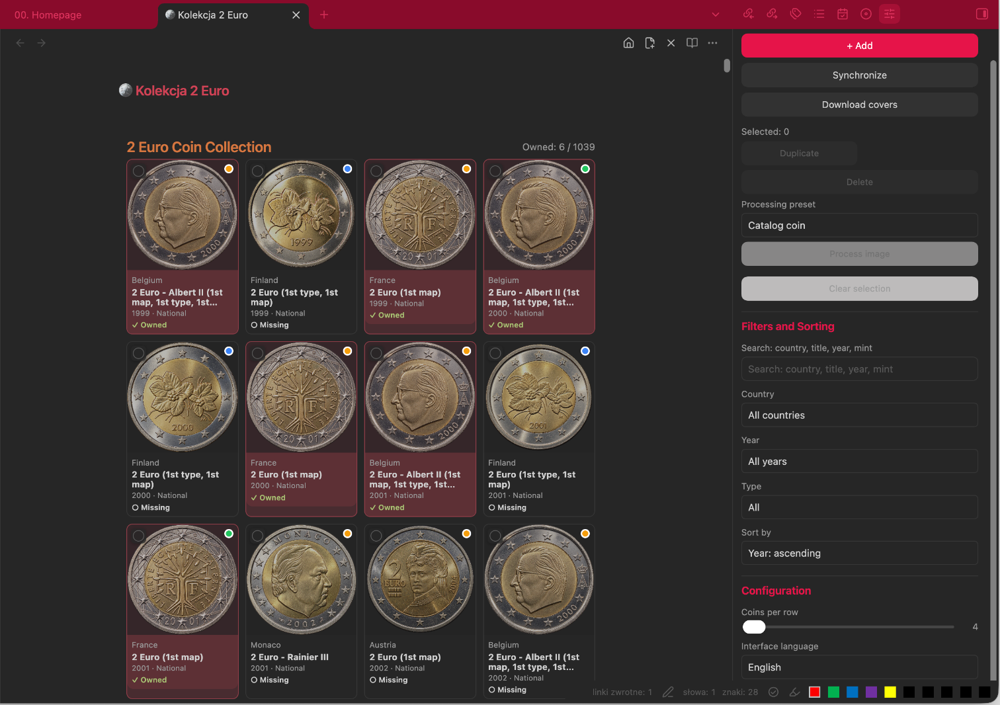
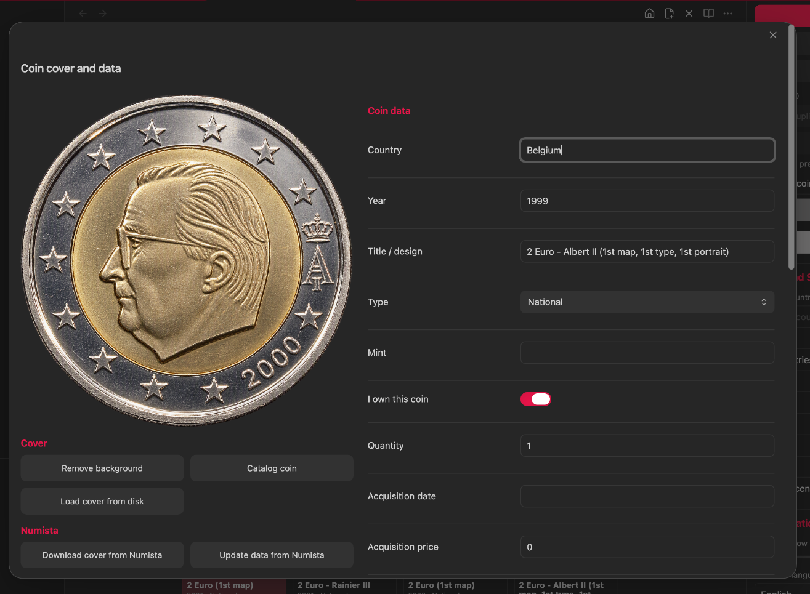
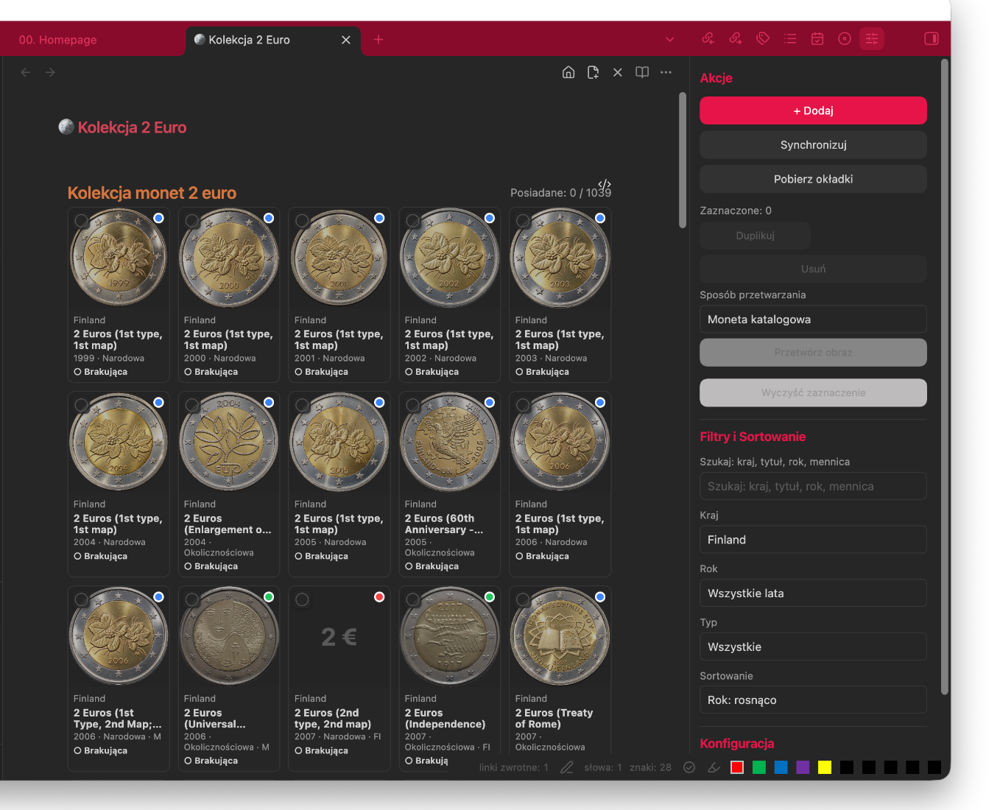
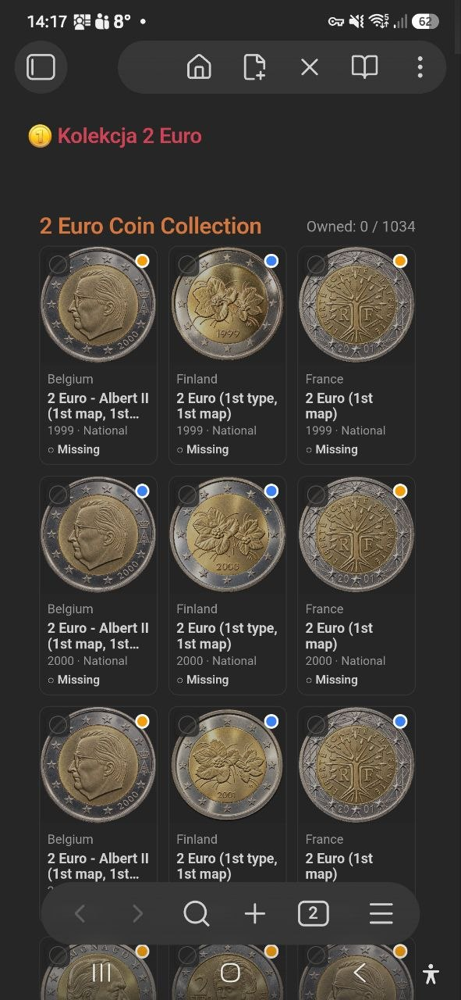
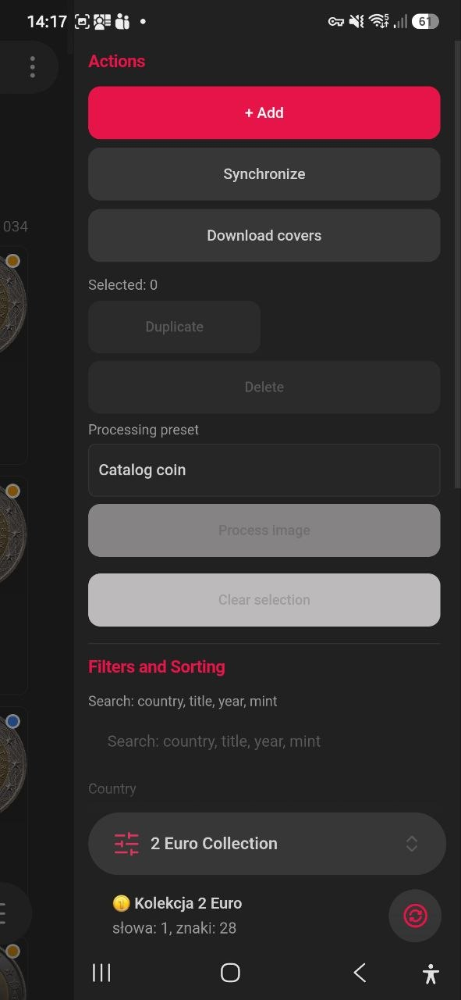
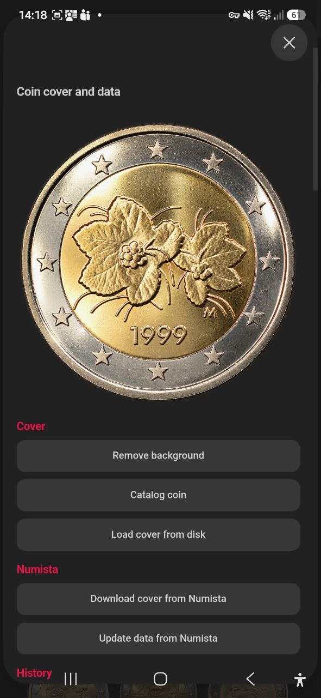

# 2 Euro Collection dla Obsidian

Mobilna wtyczka do Obsidian służąca do prowadzenia uporządkowanego katalogu monet 2 euro. Każda moneta jest zapisywana jako notatka Markdown z frontmatter YAML, okładki są przechowywane lokalnie w vault, a katalog może być synchronizowany z Numista. Wtyczka udostępnia dashboard z wyszukiwaniem, filtrami i oznaczaniem posiadanych monet.

<!-- VERSION-START -->
> Aktualna wersja wtyczki: **0.5.50**
<!-- VERSION-END -->
> Minimalna wersja Obsidian: **1.8.0**  
> Tylko desktop: **Nie**. Wtyczka działa również w Obsidian Mobile.



## Najważniejsze funkcje

- Generowanie i utrzymywanie katalogu monet 2 euro w plikach Markdown.
- Synchronizacja oficjalnych standardowych monet obiegowych oraz obiegowych monet okolicznościowych z Numista.
- Osobna notatka dla każdej emisji, rocznika i wariantu mennicy.
- Pobieranie okładek do lokalnego katalogu w vault.
- Własne okładki, blokada okładki, okładki referencyjne i dane o autorze zdjęcia.
- Oznaczanie posiadania, liczby egzemplarzy, daty i ceny nabycia, waluty, stanu oraz uwag.
- Filtrowanie po tekście, kraju, roku, posiadaniu i typie monety.
- Sortowanie po roku lub kraju, rosnąco albo malejąco.
- Zaznaczanie wielu monet, duplikowanie, usuwanie, usuwanie tła oraz preset **Moneta katalogowa**.
- Interfejs angielski i polski.
- Obsługa desktopu i telefonu.

## Instalacja

### Instalacja ręczna

1. Zamknij Obsidian albo wyłącz poprzednią wersję wtyczki.
2. W docelowym vault utwórz katalog:

   ```text
   .obsidian/plugins/two-euro-collection/
   ```

3. Skopiuj do niego pliki:

   ```text
   main.js
   manifest.json
   styles.css
   Languages/pl.json
   ```

4. Uruchom Obsidian.
5. Otwórz **Ustawienia → Wtyczki społecznościowe**.
6. W razie potrzeby wyłącz tryb ograniczony.
7. Włącz **2 Euro Collection**.

Docelowa struktura katalogu wtyczki:

```text
.obsidian/plugins/two-euro-collection/
├── main.js
├── manifest.json
├── styles.css
└── Languages/
    └── pl.json
```

> Po podmianie istniejącej wersji przeładuj Obsidian. Na telefonie upewnij się, że cały katalog `.obsidian/plugins/two-euro-collection` został zsynchronizowany z urządzeniem.

## Pierwsze uruchomienie i struktura katalogów

1. Otwórz **Ustawienia → 2 Euro Collection**.
2. Sprawdź domyślne ścieżki:
   - Katalog główny: `11 - Collections`
   - Nazwa kolekcji: `2 Euro`
   - Katalog monet: `Coins`
   - Katalog okładek: `Covers`
3. Wybierz **Utwórz / napraw strukturę → Wykonaj**.
4. Uruchom polecenie **2 Euro Collection: Otwórz kolekcję** albo użyj ikony na wstążce.

Wtyczka tworzy w razie potrzeby następującą strukturę:

```text
11 - Collections/
└── 2 Euro/
    ├── 🪙 Kolekcja 2 Euro.md
    ├── Coins/
    │   ├── Austria/
    │   ├── Belgium/
    │   └── ...
    ├── Covers/
    └── .history/
```

Notatka dashboardu zawiera blok kodu:

````markdown
```two-euro-collection
```
````

Nie usuwaj tego bloku, jeżeli dashboard ma być nadal wyświetlany.

## Generowanie danych początkowych

Dane początkowe można utworzyć na dwa sposoby.

### Wariant A: synchronizacja z Numista

1. Skonfiguruj klucz API Numista zgodnie z następną sekcją.
2. Otwórz dashboard kolekcji.
3. Otwórz prawy panel **2 Euro Collection**, jeżeli nie jest widoczny.
4. Wybierz **Synchronizuj**.
5. Poczekaj na zakończenie komunikatu postępu.
6. Wybierz **Pobierz okładki**, aby zapisać brakujące obrazy lokalnie.

Synchronizacja tworzy lub aktualizuje notatki Markdown dla oficjalnych emisji 2 euro. Wtyczka rozróżnia roczniki i warianty mennic oraz zachowuje lokalne informacje o posiadaniu i chronione lub własne okładki.

### Wariant B: ręczne dodanie monety

1. Wybierz **+ Dodaj** w prawym panelu albo uruchom polecenie **2 Euro Collection: Dodaj monetę**.
2. Uzupełnij co najmniej pola **Kraj**, **Rok** i **Tytuł / motyw**.
3. Wybierz typ **Narodowa** albo **Okolicznościowa**.
4. Dodaj oznaczenie mennicy, jeśli emisja ma wariant menniczy.
5. Wybierz **Zapisz**.

Wpisy ręczne otrzymują `source: manual` i nie są usuwane przez polecenie czyszczenia nieoficjalnych importów Numista.

## Konfiguracja API Numista

Numista udostępnia API do swojego katalogu numizmatycznego. Zaloguj się do Numista, aktywuj dostęp do API i wygeneruj klucz na stronie API. Dokumentacja: [oficjalna strona Numista API](https://pl.numista.com/api/index.php) oraz [dokumentacja API](https://en.numista.com/api/doc/index.php).

Konfiguracja we wtyczce:

1. Otwórz **Ustawienia Obsidian → 2 Euro Collection**.
2. Wklej klucz w polu **Klucz API Numista**.
3. Opuść stronę ustawień. Obsidian zapisuje ustawienia wtyczki automatycznie.
4. Uruchom **Synchronizuj**.

> Klucz API jest zapisany w danych ustawień wtyczki. Nie publikuj ani nie umieszczaj w repozytorium pliku `data.json` zawierającego rzeczywisty klucz.

### Dane odczytywane z Numista

Dla obsługiwanych oficjalnych emisji wtyczka może pobrać i zapisać:

- emitenta/kraj;
- rok i oznaczenie mennicy;
- tytuł/motyw;
- typ narodowy lub okolicznościowy;
- identyfikator typu i emisji Numista;
- adres wpisu w Numista;
- nakład;
- adres zdjęcia awersu;
- autora/prawa do zdjęcia i licencję, jeśli są dostępne;
- wartości numizmatyczne według stanów zachowania w EUR, jeśli API je udostępnia.

Synchronizator ogranicza wyniki do oficjalnych emitentów 2 euro oraz obiektów typu standardowa moneta obiegowa lub obiegowa moneta okolicznościowa. Medale, żetony, próby, wzory, emisje fantasy, pamiątki, repliki i kopie są odrzucane. Polecenie **Usuń nieoficjalne importy Numista** może oczyścić starsze dane, zachowując monety posiadane, zablokowane okładki, własne okładki i wpisy ręczne.

## Odczytywanie lokalnych danych monet

Każda pozycja katalogu jest zwykłym plikiem Markdown w katalogu `Coins`. Wtyczka odczytuje frontmatter YAML i przedstawia dane jako kartę na dashboardzie.

Przykład:

```yaml
---
coin_id: coin-12345-67890
denomination: 2
currency: EUR
country: Finland
year: "1999"
coin_type: national
title: 2 Euro (1st type, 1st map)
mint_mark: M
owned: true
quantity: 1
acquisition_date: 2026-01-15
acquisition_price: 4.50
acquisition_currency: EUR
condition: UNC
source: numista
numista_id: "12345"
numista_issue_id: "67890"
cover: "[[11 - Collections/2 Euro/Covers/Finland-1999-National-M.png]]"
reference_year: "1999"
cover_locked: true
own_cover: false
---
```

Notatki można przeglądać i edytować bezpośrednio, ale bezpieczniej używać edytora wtyczki, ponieważ normalizuje on pola i odświeża dashboard.

## Okładki i obrazy

Okładki są zapisywane w skonfigurowanym katalogu `Covers` i linkowane z frontmatter notatki monety.

### Pobieranie brakujących okładek

Wybierz **Pobierz okładki** w panelu albo uruchom polecenie **2 Euro Collection: Pobierz brakujące okładki**. Operacja:

- przetwarza wpisy Numista bez lokalnej okładki;
- pomija okładki zablokowane;
- pobiera zdjęcie awersu z Numista;
- zapisuje obraz lokalnie;
- aktualizuje notatkę Markdown.

### Zarządzanie okładką pojedynczej monety

Kliknij obraz monety, aby otworzyć okno **Okładka i dane monety**.



Dostępne akcje:

- **Usuń tło**: usuwa jasne tło i zapisuje chroniony plik PNG.
- **Moneta katalogowa**: usuwa tło, kadruje i centruje monetę, lekko koryguje kontrast i światła, zapisuje PNG oraz blokuje okładkę.
- **Pobierz okładkę z dysku**: importuje lokalny obraz, oznacza go jako własny, ustawia rok referencyjny na rok monety i blokuje okładkę.
- **Pobierz okładkę z Numista**: pobiera obraz Numista dla danej monety.
- **Uaktualnij dane z Numista**: odświeża dane katalogowe, autora/licencję zdjęcia, nakład i dostępne wartości.
- **Cofnij zmianę**: przywraca ostatni zapisany stan notatki i okładki danej monety.

### Ochrona okładki i okładki referencyjne

- **Zablokuj okładkę** (`cover_locked: true`) chroni obraz przed podmianą podczas synchronizacji i masowego pobierania.
- **Własny cover** (`own_cover: true`) również wymusza ochronę okładki.
- **Rok referencyjny okładki** pozwala użyć obrazu z innego rocznika tego samego kraju i typu monety.
- Podpowiedzi roku referencyjnego pochodzą z zablokowanych monet o tym samym kraju, tytule i typie.

### Kolory kropek na obrazach

Kropka w prawym górnym rogu obrazu opisuje stan okładki:

- **Zielona**: obraz jest zgodny z rokiem monety.
- **Pomarańczowa**: karta korzysta z obrazu referencyjnego z innego roku.
- **Czerwona**: brakuje roku referencyjnego albo nie udało się odnaleźć wskazanej okładki referencyjnej.
- **Niebieska**: używana jest własna, chroniona okładka.

Kolory kropek opisują obraz i referencję. Nie oznaczają posiadania monety.

## Filtrowanie i sortowanie

Otwórz prawy panel poleceniem **2 Euro Collection: Otwórz panel kolekcji**. Dostępne filtry:

- **Szukaj**: kraj, tytuł, rok lub mennica;
- **Kraj**;
- **Rok**;
- **Wszystkie**;
- **Posiadane**;
- **Brakujące**;
- **Okolicznościowe**;
- **Narodowe**.

Dostępne sortowanie:

- Rok: rosnąco;
- Rok: malejąco;
- Kraj: rosnąco;
- Kraj: malejąco.

Licznik nad siatką jest obliczany dla aktualnie przefiltrowanej listy, na przykład `Posiadane: 6 / 48` po zastosowaniu filtrów.



## Edycja monet i filtry edycyjne

### Edycja pełnych danych monety

Kliknij opis pod obrazem, aby otworzyć standardowy edytor. Kliknij obraz, aby otworzyć łączony edytor okładki i danych.

Pola edytowalne:

- Kraj;
- Rok;
- Tytuł / motyw;
- Typ;
- Mennica;
- Mam tę monetę;
- Liczba egzemplarzy;
- Data nabycia;
- Cena i waluta nabycia;
- Stan;
- URL okładki;
- Rok referencyjny okładki;
- Zablokuj okładkę;
- Własny cover;
- Uwagi;
- Autor/prawa do zdjęcia;
- Licencja zdjęcia.

Pole wartości numizmatycznej jest tylko do odczytu, ponieważ jest uzupełniane z Numista.

### Filtr podpowiedzi roku referencyjnego

Podczas edycji pola **Rok referencyjny okładki** wtyczka proponuje lata wyłącznie z monet spełniających wszystkie warunki:

1. ten sam kraj;
2. ta sama znormalizowana nazwa;
3. ten sam typ monety;
4. zablokowana okładka kandydata;
5. dostępna lokalna okładka kandydata.

Dzięki temu obrazy niezwiązanych monet nie są proponowane jako referencje.

### Operacje masowe i przetwarzanie obrazu

1. Zaznacz karty polem wyboru w lewym górnym rogu.
2. Panel pokaże liczbę zaznaczonych monet.
3. W sekcji **Sposób przetwarzania** wybierz **Moneta katalogowa** albo **Usuń tło**.
4. Naciśnij **Przetwórz obraz**.
5. Po zakończeniu wybierz **Wyczyść zaznaczenie**.

Zaznaczone monety można również duplikować lub usuwać. Usunięcie wymaga potwierdzenia i nie może zostać cofnięte z poziomu operacji masowej.

## Oznaczanie posiadania

Moneta jest posiadana, gdy włączone jest pole **Mam tę monetę**, co zapisuje `owned: true` we frontmatter.

- Karta posiadanej monety pokazuje `✓ Posiadana`.
- Karta brakującej monety pokazuje `○ Brakująca`.
- W wersji 0.5.46 posiadane monety mają czerwono zabarwione tło karty.
- Licznik u góry pokazuje liczbę posiadanych względem wszystkich pozycji pozostałych po zastosowaniu filtrów.
- Pole **Liczba egzemplarzy** służy do rejestrowania wielu sztuk.

> Posiadanie jest sygnalizowane tłem karty. Zielona, pomarańczowa, czerwona i niebieska kropka na obrazie oznaczają stan okładki lub referencji.

## Używanie na telefonie

Wtyczka nie jest ograniczona do desktopu. Zainstaluj albo zsynchronizuj cały katalog wtyczki do mobilnego vault, włącz wtyczkę w **Wtyczkach społecznościowych** i otwórz notatkę kolekcji.

Na telefonie:

- dashboard automatycznie korzysta z siatki trzech kolumn;
- panel kolekcji można otworzyć ikoną panelu wtyczki;
- filtry, synchronizacja, pobieranie okładek i operacje masowe pozostają dostępne;
- edytor monety przełącza się na układ jednokolumnowy;
- dotknięcie obrazu otwiera okładkę i dane monety;
- dotknięcie tekstu pod obrazem otwiera standardowy edytor.

### Dashboard mobilny



### Akcje, filtry i sortowanie na telefonie



### Mobilny edytor okładki i danych



## Język interfejsu i układ

W prawym panelu lub ustawieniach wtyczki można wybrać:

- **Automatyczny**;
- **English**;
- **Polski**.

Suwak **Monet w wierszu** obsługuje wartości od 4 do 10 na desktopie. Na telefonie układ responsywny używa trzech kolumn.

## Przydatne polecenia

Otwórz paletę poleceń i wyszukaj **2 Euro Collection**. Najważniejsze polecenia:

- Otwórz kolekcję;
- Otwórz panel kolekcji;
- Dodaj monetę;
- Synchronizuj katalog z Numista;
- Pobierz brakujące okładki;
- Usuń duplikaty;
- Usuń tło z okładki aktualnej monety;
- Zastosuj preset Moneta katalogowa do aktualnej monety;
- Uporządkuj nazwy chronionych okładek PNG;
- Napraw nazwy monet 2 Euro;
- Uporządkuj nazwy katalogów krajów;
- Migruj odwołania do okładek;
- Usuń nieoficjalne importy Numista.

## Kopia zapasowa i bezpieczeństwo zmian

Przed dużą synchronizacją, czyszczeniem, normalizacją nazw, migracją okładek albo masowym usuwaniem:

1. zamknij otwarte edytory monet;
2. wykonaj kopię vault albo commit Git;
3. sprawdź, czy własne okładki mają włączone **Własny cover** lub **Zablokuj okładkę**;
4. przy aktualizacji ze starszej wersji przetestuj operację na kopii vault.

## Rozwiązywanie problemów

### Wtyczka nie jest widoczna na liście wtyczek społecznościowych

- Sprawdź, czy katalog nazywa się dokładnie `.obsidian/plugins/two-euro-collection`.
- Sprawdź, czy `manifest.json`, `main.js` i `styles.css` są bezpośrednio w tym katalogu.
- Przeładuj Obsidian.
- Sprawdź `.obsidian/community-plugins.json` i upewnij się, że po włączeniu wtyczki znajduje się tam `two-euro-collection`.

### Brak języka polskiego

Sprawdź, czy plik istnieje pod ścieżką:

```text
.obsidian/plugins/two-euro-collection/Languages/pl.json
```

Nazwa katalogu zaczyna się wielką literą `L`.

### Synchronizacja prosi o klucz API

Otwórz **Ustawienia → 2 Euro Collection**, wprowadź poprawny klucz Numista i ponownie uruchom synchronizację.

### Okładki nie są wyświetlane

- Uruchom **Migruj odwołania do okładek** dla starych linków zawierających tylko nazwę pliku.
- Sprawdź, czy pliki znajdują się w skonfigurowanym katalogu `Covers`.
- Uruchom **Pobierz brakujące okładki** dla niezablokowanych wpisów Numista.
- Sprawdź pola `cover_locked`, `own_cover` i `reference_year` w notatce monety.

### Synchronizacja jest wolna albo pojawia się HTTP 429

Wtyczka zachowuje odstępy między wywołaniami API i ponawia żądania ograniczone przez usługę z rosnącym opóźnieniem. Pozostaw Obsidian uruchomiony do zakończenia komunikatu postępu. Nie uruchamiaj jednocześnie kilku synchronizacji lub pobierań okładek.

## Własność danych i treści zewnętrzne

Notatki monet i pobrane okładki są zapisywane w vault użytkownika. Dane katalogowe i zdjęcia z Numista podlegają warunkom Numista oraz informacjom o licencji i autorze dostarczonym z obrazem. Przy dalszym udostępnianiu obrazów lub wygenerowanych materiałów zachowaj pola `photo_author`, `photo_license` i informacje o źródle.

## Zrzuty ekranu

Zrzuty w katalogu `Assets/` są przykładami dokumentacyjnymi. Zrzuty desktopowe zostały przycięte tak, aby pokazywać wtyczkę bez prywatnego głównego menu Obsidian autora.

## Licencja

W aktualnym pakiecie wtyczki nie zadeklarowano licencji oprogramowania. Przed publiczną dystrybucją dodaj plik `LICENSE`, jeżeli inni użytkownicy mają mieć prawo do ponownego użycia kodu.
